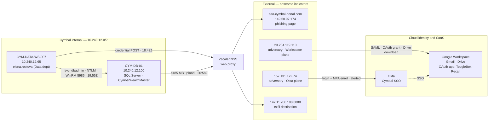

> [!success] Solved — 2026-10-30 05:29 (platform-local) · 6/6 accepted · "Scenario Pwned"
> No `HTB{}` string exists for this room. It is question-graded, six short answers. All six were read from vendor-native raw-log fields in the live SecOps tenant and accepted on first submission.
>
> | # | Question (short) | Answer | Evidence source |
> |---|---|---|---|
> | 1 | Phishing domain that received the credential POST | `sso-cymbal-portal.com` | Zscaler `url` and `requestmethod=POST` |
> | 2 | Subject of the first purged MFA-change alert | `Okta: A new MFA factor was added` | Gmail audit `subject`, `action_type 71`, OAuth `client_id` |
> | 3 | Sensitive document downloaded | `Cymbal_Q3_Database_Architecture_and_Service_Accounts.pdf` | Drive audit `item_download` → `doc_title` |
> | 4 | Service account used from the workstation to the DB server | `svc_dbadmin` | Security 4624 on CYM-DB-01 → `TargetUserName`, `WorkstationName` |
> | 5 | Raw database dump file | `cymbal_cust_q3.bak` | Sysmon EID 1 on CYM-DB-01 → `CommandLine` target path |
> | 6 | Full exfiltration URL | `http://142.11.200.188:8888/upload/cymbal_q3_exfil.tar.zst` | Zscaler `url`, `filetype=ZSTD` |
>
> Easy · 850 points · live SecOps instance required for every flag.

> [!info] Scenario, verbatim
> Welcome to the Cymbal Investments Security Operations Center. A high-priority threat bulletin from Google Threat Intelligence covering SHINYHUNTERS has landed in your Emerging Threats. Leveraging the full power of Google SecOps, from SIEM search and Curated Detections to Google Threat Intelligence (GTI) adversary reporting, your mission is to investigate the initial identity compromise and uncover the full scope of the incident.

> [!note] Scope of this note
> This note records the hunt: queries, the raw-log fields read, the evidence timeline, decoys, and defender takeaways. It does not walk through attacker tradecraft beyond what the logs and Sysmon `RuleName` labels already state. Event index: [[00_MOC-HTB-COLDROOM2026-Operation-Cymbal-Cold-Room-Event]].

> [!warning] Time display offset in this tenant
> Grid timestamps render **+1 h** against raw UTC for every row type checked, detection rows included. Gmail `EMAIL_TRANSACTION` rows only *look* like +3 h: they carry their **ingestion** time as the event time (purge: action 19:05:19Z, ingested 21:11:13Z, shown 22:11:13). [Unverified] cause. Times marked **(raw)** were read from the raw log, the identity rows on 31 Oct. Times marked **(grid−1h)** come from the grid only.

---

## 0. How the flags were obtained

1. Proxy search for POSTs to login-shaped URL paths in the Cymbal namespace, 8–26 Oct → **1 hit**. Raw Log → `url`, `refererURL`, `user`, `clientIP`. **Flag 1.** This fixed the victim (elena.rostova), her workstation IP (10.240.12.65) and the date (15 Oct).
2. Victim search across user-id, email and IP fields → 15 events, spanning Okta, Workspace, proxy, endpoint and Windows Security.
3. Gmail transaction search scoped to the Cymbal namespace → 16 events, 14 of them from unrelated users. Raw Log on the two belonging to elena: `subject`, `action_type 71`, `client_id`. **Flag 2** is the earlier of the two.
4. Workspace audit search scoped to the victim and attacker IP → Raw Log on the Drive rows: the `search` query text and the `item_download` `doc_title`. **Flag 3.**
5. Combined search on the workstation hostname, its IP and `svc_dbadmin` → 14 events. Raw Log on the `USER_LOGIN` → 4624 on **CYM-DB-01**. **Flag 4.**
6. Same result set, DB-server endpoint rows → `sqlcmd.exe` `CommandLine` target path. **Flag 5.**
7. Same result set, the `NETWORK_HTTP` row from `svc_dbadmin` → Zscaler `url`. **Flag 6.** Cross-checked against the Sysmon EID 3 to the same IP:port 20 s earlier.

---

## 1. Shape of the challenge

**Target.** Same `ctf-us-03` tenant and same day (2026-10-15) as the other two Cold Room incidents. Third victim, third entry point. The room is framed around a SHINYHUNTERS bulletin in Emerging Threats. The GTI bulletin itself was not needed: the question text fixed every search.

**Log sources observed:**

| Log type | Product | Covered here |
|---|---|---|
| `ZSCALER_WEBPROXY` | Zscaler NSS | Phishing page GET and POST, exfil POST from the DB server |
| Okta System Log | Okta | Victim login, adversary login, `user.mfa.factor.activate` (alerted) |
| `WORKSPACE_ACTIVITY` | Google Workspace admin reports | `saml_sso_login`, OAuth grant (alerted), Drive `search` and `item_download` |
| `EMAIL_TRANSACTION` | Gmail audit (via Workspace) | Two `action_type 71` events carrying the OAuth app's `client_id` |
| `WINEVTLOG` | Microsoft-Windows-Security-Auditing | 4624 on CYM-DB-01 |
| `WINDOWS_SYSMON` | Microsoft-Windows-Sysmon | EID 1 / 3 / 11 on CYM-DATA-WS-007 and CYM-DB-01, `RuleName` pre-labelled |

**The structural facts that mattered:**

* **Two adversary IPs on two identity planes.** 157.131.172.74 appears only in Okta. 23.234.119.110 appears only in Workspace (SAML, OAuth, Gmail, Drive). The Flag 3 question's "attacker's proxy infrastructure" is the second IP.
* **The mailbox purge has no literal "deleted" field.** It shows as Gmail `delivery` events with `action_type 71` and the just-authorised OAuth app's `client_id`. Only two such events exist for the victim, so "first" was unambiguous. Google's schema defines `action_type 71` as a post-delivery action a user took on the message, with opening, clicking a link and downloading an attachment given as examples. It does not name deletion. The "purge" reading comes from the scenario's question, and the answer was accepted (§13).
* **No malware on the workstation.** The only endpoint artefact on CYM-DATA-WS-007 is `Ssms.exe` launched interactively. The pivot is credential reuse from a document.
* **The grid `Hostname` column shows `WorkstationName` on 4624**, the *source*. As in Deceptive Click, the `svc_dbadmin` logon looked like a workstation logon until the raw `Hostname: CYM-DB-01.cymbal.corp` was read.

---

## 2. Network map and asset inventory



| Asset | IP | Role | Evidence that fixes it |
|---|---|---|---|
| CYM-DATA-WS-007.cymbal.corp | 10.240.12.65 | Victim workstation, Data dept | Zscaler `clientIP` and `department=Data`; 4624 `WorkstationName` / `IpAddress` |
| CYM-DB-01.cymbal.corp | 10.240.12.100 | Internal SQL server, database `CymbalWealthMaster` | 4624 `Hostname`; Sysmon `Computer`; Zscaler `clientIP` on the exfil POST |
| elena.rostova | Workspace profileId 10829103849102 | Compromised employee | Zscaler `user`; Okta; Workspace `actor.email` |
| svc_dbadmin | SID …-192837465-**1089**, LogonId `0x6E1F4` on DB-01 | Privileged service account reused from the stolen document | 4624 `UserID`; Sysmon `User` / `LogonId` |
| ToogleBox Recall | `918237461928-tooglebox-recall.apps.googleusercontent.com` | OAuth app used for the mailbox purge | Gmail audit `client_id`; Workspace `USER_RESOURCE_ACCESS` alert |

Subnet masks are not in the data, so `/?` is deliberate. [Guessing] that workstation and DB server share one /24, based on the third octet alone. [Inference] If that guess holds, a database server in the same segment as user workstations is a finding in its own right. That it was reachable over WinRM from a workstation is [Certain] (4624 and `wsmprovhost.exe` at 19:55Z, §4) and is a finding either way (§10).

---

## 3. Cyber Kill Chain mapping (defender view)

Phase → what happened → the record it rests on → where a control could have broken the chain.

| # | Phase | What happened | Basis (record) | Confidence | ATT&CK | Break point |
|---|---|---|---|---|---|---|
| 1 | Reconnaissance | Outside the evidence. The look-alike domain implies prior knowledge of the company's name and sign-in branding. | No record; inferred from the domain name | [Inference] | — | Look-alike-domain monitoring |
| 2 | Weaponization | Look-alike domain `sso-cymbal-portal.com` hosting a sign-in page at `/auth/login`. | Zscaler `refererURL=…/auth/login`, `serverip=149.50.97.174` (18:42:14) | [Certain] it existed. [Inference] it was prepared in advance. | — | Domain watch and pre-emptive block |
| 3 | Delivery | A targeted, personalised link. Her first request to the phishing page carried her username as a parameter and had no referring page, so no web redirect or drive-by led her there. The channel (email, text, chat or call) is not in the logs. | Zscaler first contact 18:41:19 (grid−1h); parameter and referrer read from the raw record; no lure in the Gmail audit records searched (Q5, Q6) | [Certain] personalised link, no referrer, no corporate lure. [Unverified] the channel. | T1566.002 (delivery not evidenced, §9) | Proxy categorisation of new and look-alike domains |
| 4 | Exploitation | Credential POST, then an adversary Okta sign-in as the victim through a NordVPN exit that Okta labels "suspicious proxy IP". No MFA challenge is logged before that sign-in. Workspace was reached separately from a second IP. | Zscaler POST 18:42:14; Okta `user.authentication.sso` from 157.131.172.74 (Cloudflare AS13335), 18:48:09; Workspace `saml_sso_login` from 23.234.119.110, 18:55:24 | [Certain] on the records. [Inference] the missing challenge means a captured session or no prompt on that sign-in. | T1598.003 · T1078.004 | Phishing-resistant MFA; block or step up sign-ins from anonymising proxies |
| 5 | Installation | No malware. Persistence sits in the identity: an adversary-enrolled MFA factor and an authorised OAuth app with mailbox scope. Both matched detections, but those were generated only after the exfiltration (§4). | Okta `user.mfa.factor.activate` 18:49:29; Workspace token `authorize` 19:01:19; detections created 23:05:12 and 21:11:45 | [Certain] | T1098.005 · T1556.006 · T1671 | Admin-gated MFA enrolment; admin-only OAuth app approval; real-time identity detection with a triage SLA |
| 6 | Command & Control | Ordinary SaaS sessions from two external IPs, plus the OAuth app. No implant channel. | Okta records from 157.131.172.74; Workspace records from 23.234.119.110; no beacon among the workstation's proxy rows in Q2 | [Certain] for those records | T1078.004 | New-location / impossible-travel sign-in review |
| 7 | Actions on Objectives | Two security-alert emails acted on through the OAuth app (Gmail `action_type 71`, which the scenario frames as a purge; §13). Drive searched and a credentials document downloaded. Service account reused from the workstation to the DB server. Database backup created, compressed and uploaded (about 485 MB). Extortion note written. | Gmail `action_type 71` ×2 (19:05:19, 19:06:39); Drive `search` 19:28:09, `item_download` 19:31:49; 4624 on CYM-DB-01 19:55:24; Sysmon EID 1 / 11 on DB-01 19:58:09–20:28:09; Zscaler POST 20:58:19 | [Certain] for the events. T1552.001 [Inference] (§9) | T1070.008 · T1213 · T1552.001 · T1078.002 · T1021.006 · T1570 · T1560.001 · T1048.003 · T1657 | Secrets out of documents; service-account logon restrictions; server egress control |
| — | *End state (beyond the model)* | Not shown. Whether the MFA factor, the OAuth grant and the `svc_dbadmin` password were still valid when the evidence ends was not established: no revocation or reset was identified, and none was searched for specifically. | — | [Unverified] | — | Revoke the factor and the grant; reset `svc_dbadmin` |

### 3.1 What the Kill Chain view leaves out

Only the limits that bite in this room:

| Limit | Here |
|---|---|
| Built around malware intrusions | No malware was used. Installation and C2 are filled with identity persistence (an MFA factor, an OAuth grant) and SaaS sessions, which the model was not designed to describe. |
| "C2" assumes an implant beaconing out | There is no implant. The "C2" row is the adversary's own signed-in sessions. |
| No phase for credential reuse across a trust boundary | Two such hops: the phished password used in Okta and then for SSO into Workspace from a second IP; and the `svc_dbadmin` credential taken from a Drive document and used against CYM-DB-01. |
| One phase for everything after the foothold | Mailbox purge, Drive discovery, lateral movement, collection, exfiltration and extortion all sit in phase 7. |
| Linear, with no end state | Whether the factor and the grant were still live when the evidence ends is not shown (end-state row). |

### 3.2 Diamond Model — summary

Method: the Diamond Model of Intrusion Analysis.

| Vertex | In this room | Evidence | Confidence |
|---|---|---|---|
| Adversary | Unattributed. The scenario frames the room with "A high-priority threat bulletin from Google Threat Intelligence covering SHINYHUNTERS". That is the room's framing, not an attribution. | Scenario text | [Certain] for the framing. No attribution made. |
| Capability | Credential-harvesting page (T1598.003); valid cloud accounts (T1078.004); rogue MFA factor (T1098.005); OAuth app "ToogleBox Recall" (T1671) used on two security-alert emails (T1070.008, on the scenario's purge framing); Drive search and download (T1213); `svc_dbadmin` reuse over WinRM (T1078.002, T1021.006); `sqlcmd` backup and `zstd` (T1570, T1560.001); HTTP upload (T1048.003); extortion note (T1657). | §4 timeline | [Certain] for the events. T1552.001 [Inference] (§9). |
| Infrastructure | **Phishing:** `sso-cymbal-portal.com` (149.50.97.174), Type 1 [Inference]. **Okta access:** 157.131.172.74, a NordVPN exit on Cloudflare AS13335, Type 2 [Certain, from Okta `securityContext`]. **Workspace access:** 23.234.119.110, type not determinable from the data. **Exfiltration:** 142.11.200.188:8888, Type 1 [Inference]. Four separate endpoints; blocking the two sign-in addresses would not have stopped the upload. | Zscaler; Okta `securityContext`; Workspace `ipAddress` (§4) | As marked |
| Victim | **Persona:** Cymbal Investments; a Data-department analyst; the `CymbalWealthMaster` customer database. **Asset:** `elena.rostova`'s Okta and Workspace accounts; CYM-DATA-WS-007; CYM-DB-01; `svc_dbadmin`. | §2 asset table | [Certain] |

**Result:** Success. Confidentiality compromised (about 485 MB database backup uploaded, §4 20:58:19); two security alerts acted on in the mailbox (the scenario's "purge") · **Direction:** Infrastructure-to-Victim for the sign-ins, Victim-to-Infrastructure for the upload · **Phases:** Kill Chain 2–7

**Activity thread** (each phase used different infrastructure):

| Event | Phase | Infrastructure | Capability | Victim asset |
|---|---|---|---|---|
| Credential POST, 18:42:14 | 4 | `sso-cymbal-portal.com` | Phishing page | `elena.rostova`, via her workstation browser |
| Okta sign-in and factor enrolment, 18:48:09–18:49:29 | 4–5 | 157.131.172.74 | Valid account; MFA device registration | Okta account |
| Workspace SAML, OAuth grant, purge, Drive download, 18:55:24–19:31:49 | 5–7 | 23.234.119.110 | OAuth app; mailbox purge; Drive search | Workspace account |
| Upload, 20:58:19 | 7 | 142.11.200.188:8888 | HTTP POST from DB-01 | CYM-DB-01, `CymbalWealthMaster` |

**Limits** (part of the honest-scope rule): the adversary vertex holds the scenario's framing and nothing more, and one room is not an attribution. Infrastructure types rest on the log fields shown; registration and hosting records were not queried. Cross-room comparison belongs in [[00_MOC-HTB-COLDROOM2026-Operation-Cymbal-Cold-Room-Event]].

---

## 4. Evidence timeline

2026-10-15. **(raw)** = read from the raw log. **(grid−1h)** = grid only, raw not opened. **(secondary)** = taken from a secondary summary of the raw record, not re-read for this note.

| Time (UTC) | Host / plane | Observation | Key fields | Tag |
|---|---|---|---|---|
| 18:28:19 (raw) | Okta | elena.rostova login from 10.240.12.65 | `USER_LOGIN`; Windows / Chrome 124, Denver, device CYM-DATA-WS-007 | Baseline |
| 18:31:29 (grid−1h) | Proxy | Victim → `intranet` | — | Baseline |
| 18:41:19 (grid−1h) | Proxy | Victim → `sso-cymbal-portal.com` | first contact | Delivery |
| **18:42:14 (raw)** | Proxy | **POST `https://sso-cymbal-portal.com/api/v1/auth/token`** | `refererURL=…/auth/login`, `serverip=149.50.97.174`, `action=Allowed`, `threatname=None`, `pagerisk=25` | **Flag 1** |
| 18:45:09 (raw) | Okta | `device.mfa.register` by **sarah.jenkins** from 10.240.12.45 | client device `CYM-ADMIN-WS-002`, device "MacBookPro18,1", severity INFO, AS "Cymbal Investments" | Admin noise (§6) |
| 18:48:09 (raw) | Okta | `user.authentication.sso` as elena.rostova from **157.131.172.74** | Okta `securityContext`: NordVPN exit on Cloudflare AS13335, `isProxy` true, "Chicago"; Mac / Chrome 143; Okta message "suspicious proxy IP" (WARN) | Adversary |
| 18:49:29 (raw) | Okta | `user.mfa.factor.activate` from 157.131.172.74: "User enrolled rogue device factor from anonymized proxy" | device "Macintosh (Sonoma 14.4)", fingerprint `fp_8a92f019b7`; detection created 23:05:12 UTC | Adversary; detection after exfil |
| 18:55:24 (raw) | Workspace | `saml_sso_login` from **23.234.119.110**, IdP Okta | `STATUS_UPDATE` | Adversary |
| 19:01:19 (raw) | Workspace | token `authorize`, app "ToogleBox Recall" | `client_id=918237461928-tooglebox-recall.apps.googleusercontent.com`; scopes `https://mail.google.com/` and `gmail.modify`, no Drive scope; detection created 21:11:45 UTC | Adversary; detection after exfil |
| **19:05:19 (raw)** | Gmail | `delivery`, `action_type 71`, **subject "Okta: A new MFA factor was added"** | `client_id=…tooglebox-recall…`, `ipAddress=23.234.119.110`, msg-id `<mfa-alert-981240@okta…>` | **Flag 2** |
| 19:06:39 (raw) | Gmail | `delivery`, `action_type 71`, subject "Security alert: New macOS device registered to your account" | same `client_id`, same IP | Second purge |
| 19:15:24 (grid−1h) | WS-007 | `Ssms.exe` launched by `explorer.exe` as elena.rostova | EID 1 | [Unverified] victim or adversary |
| 19:18:39 (grid−1h) | Proxy | Victim → `slack.com` | — | Noise |
| **19:28:09 (raw)** | Drive | `search`, query text names `connection_string`, `database`, `master`; `results_count=4` | `ipAddress=23.234.119.110` | Discovery |
| **19:31:49 (raw)** | Drive | **`item_download` `Cymbal_Q3_Database_Architecture_and_Service_Accounts.pdf`** | `doc_type=pdf`, `owner=elena.rostova@…`, `ipAddress=23.234.119.110` | **Flag 3** |
| 19:43:09 (secondary) | DB-01 | **sarah.jenkins** opens a WinRM session from `CYM-ADMIN-WS-002` | Sysmon | Admin noise (§6) |
| **19:55:24 (raw)** | DB-01 | **4624 `svc_dbadmin`** | `LogonType 3`, `NtLmSsp`, `NTLM`, `WorkstationName=CYM-DATA-WS-007`, `IpAddress=10.240.12.65`, `IpPort=52180`, SID …-1089 | **Flag 4** |
| 19:55:39 (raw) | DB-01 | EID 1 `wsmprovhost.exe -Embedding` | `User=svc_dbadmin`, LogonId `0x6E1F4`, parent `svchost -k DcomLaunch` | RuleName T1021.006 |
| **19:58:09 (raw)** | DB-01 | **EID 1 `sqlcmd.exe`, local server, database `CymbalWealthMaster`, target `C:\ProgramData\MSSQL\Backup\cymbal_cust_q3.bak`** | parent `wsmprovhost.exe`, LogonId `0x6E1F4` | **Flag 5**, RuleName T1565.001 |
| 20:18:19 (raw) | DB-01 | EID 11 `C:\ProgramData\zstd.exe` | Image `wsmprovhost.exe` | RuleName T1074 |
| 20:21:39 (raw) | DB-01 | EID 1 `zstd.exe`, input the `.bak`, output `C:\ProgramData\cymbal_q3_exfil.tar.zst` | LogonId `0x6E1F4` | RuleName T1560.001 |
| 20:28:09 (raw) | DB-01 | EID 11 `C:\ProgramData\README-IF-YOU-SEE-THIS-YOUVE-BEEN-HACKED.TXT` | Image `wsmprovhost.exe` | RuleName T1491 |
| 20:57:59 (raw) | DB-01 | EID 3 `powershell.exe` → 142.11.200.188:**8888** | `SourceIp=10.240.12.100`, `SourcePort=54912` | RuleName T1048 |
| **20:58:19 (raw)** | Proxy | **POST `http://142.11.200.188:8888/upload/cymbal_q3_exfil.tar.zst`** | `filetype=ZSTD`, `requestsize=485120000`, `user=svc_dbadmin`, `clientIP=10.240.12.100`, `action=Allowed` | **Flag 6** |
| 21:11:09 (secondary) | DB-01 | **sarah.jenkins** launches a SQL health-check script interactively | Sysmon, parent `explorer.exe` | Admin noise (§6) |

**Elapsed:** credential POST to exfil upload is **2 h 16 min**. [Certain] on the two raw endpoints.

> [!example] Evidence exhibit — the first purged alert
> | Field | Value |
> |---|---|
> | Record | Gmail audit, `delivery` |
> | `id.time` | `2026-10-15T19:05:19Z` |
> | `action_type` | `71` |
> | `subject` | `Okta: A new MFA factor was added` |
> | `client_id` | `…tooglebox-recall…` (full value in §2) |
> | `ipAddress` | `23.234.119.110` |
> | Message ID | `<mfa-alert-981240@okta…>` |
>
> Source: `EMAIL_TRANSACTION` (Gmail via Workspace), raw JSON; the UDM `event_timestamp` is the ingestion time, 21:11:13Z. [Certain] — every value read from the original record.
>
> **Limits of the proof:** no field says "deleted". Google defines `action_type 71` as a post-delivery action, not specifically deletion (§13), so the purge reading rests on the scenario's framing together with the OAuth app's `client_id` [Inference].

---

## 5. Search log

Case sensitivity **Off**. UDM syntax in SIEM Search, run by URL.

| # | Window (UTC) | Query | Result | How reviewed | Yielded |
|---|---|---|---|---|---|
| Q1 | 10-08 → 10-26 | `metadata.event_type = "NETWORK_HTTP" AND network.http.method = "POST" AND target.url = /login\|signin\|sso\|okta\|auth\|verify\|account/ nocase AND principal.namespace = "Cymbal"` | 1 | Raw Log (Zscaler key=value): `url`, `refererURL`, `requestmethod`, `user`, `clientIP`, `serverip`, `department` | **Flag 1**; victim, IP, date |
| Q2 | 10-08 → 10-26 | `principal.user.userid = /elena.rostova/ nocase OR target.user.userid = /elena.rostova/ nocase OR principal.user.email_addresses = /elena.rostova/ nocase OR target.user.email_addresses = /elena.rostova/ nocase OR principal.ip = "10.240.12.65" OR target.ip = "10.240.12.65"` | 15 | Grid scraped: time, type, summary, user, host | Full incident spine; both adversary IPs; `svc_dbadmin` |
| Q3 | 10-08 → 10-26 | `metadata.log_type = "WORKSPACE_ACTIVITY" AND principal.namespace = "Cymbal"` | 29 (11 alerts) | Grid scanned | Negative: dominated by daily `charlie.brown` Custom Rule alerts; victim rows not surfaced. Discarded |
| Q4 | 10-08 → 10-26 | `metadata.log_type = "WORKSPACE_ACTIVITY" AND (principal.user.email_addresses = /elena/ nocase OR target.user.email_addresses = /elena/ nocase OR principal.ip = "23.234.119.110" OR principal.user.userid = /elena/ nocase)` | 6 | Raw Log (Workspace `admin#reports#activity` JSON), parsed `id.time`, `actor.email`, `ipAddress`, `events[].parameters` | **Flags 2 and 3**; Drive search text |
| Q5 | 10-14 → 10-17 | `metadata.event_type = "EMAIL_TRANSACTION"` | 14 | Grid scanned | Negative: all `mikeross` / `timaddler` |
| Q6 | 10-14 → 10-17 | `metadata.event_type = "EMAIL_TRANSACTION" AND (network.email.to = /elena\|cymbal-investments/ nocase OR network.email.from = /cymbal-investments/ nocase OR principal.user.email_addresses = /elena/ nocase OR principal.namespace = "Cymbal")` | 16 | Opened the two elena rows → Raw Log JSON | Confirmed both purge events and their order |
| Q7 | 10-15 18:00 → 10-16 06:00 | `principal.hostname = /CYM-DATA-WS-007/ nocase OR principal.ip = "10.240.12.65" OR target.ip = "10.240.12.65" OR principal.user.userid = /svc_dbadmin/ nocase OR target.user.userid = /svc_dbadmin/ nocase` | 14 | Opened every DB-01 row and the 4624 → Raw Log (Sysmon XML / WINEVTLOG JSON / Zscaler) | **Flags 4, 5, 6**; LogonId thread `0x6E1F4`; EID 3 cross-check |
| Q8 | 10-15 17:30 → 20:00 | `principal.user.userid = /elena/ nocase OR target.user.userid = /elena/ nocase OR principal.user.email_addresses = /elena/ nocase OR target.user.email_addresses = /elena/ nocase` | 12 (2 detections) | Grid scraped; Detections tab read for event and created times | Victim timeline re-confirmed; detections created 21:11:45 and 23:05:12 UTC (grid shows +1 h) |
| Q9 | 10-01 → 10-29 | `metadata.vendor_name = /okta/ nocase AND principal.namespace = "Cymbal"` | 7 | Raw Log on each factor event | Two factor enrolments: the adversary's and sarah.jenkins' 18:45:09 |
| Q10 | 10-01 → 10-29 | `additional.fields.value.string_value = /8a92f019\|Sonoma/ nocase OR principal.asset.hardware.model = /Macintosh/ nocase OR metadata.product_event_type = "user.mfa.factor.activate"` | 1 | Grid | Only the adversary's enrolment |
| Q11 | 10-01 → 10-29 | `metadata.vendor_name = /okta/ nocase AND (network.http.user_agent = /Macintosh\|Mac OS/ nocase OR principal.ip = "157.131.172.74")` | 597 | Grid scanned | Negative: the tenant's other demo dataset. Discarded; Q9 replaces it |
| Q12 | 10-01 → 10-29 | `network.sent_bytes > 10000000`, then `network.sent_bytes > 1000000` | 2, then 2 | Grid | Only the 20:58 exfil and an internal Rogue Synthesis registry push |
| Q13 | 10-01 → 10-29 | `additional.fields.value.string_value = /tooglebox\|918237461928/ nocase OR principal.application = /tooglebox/ nocase OR target.application = /tooglebox/ nocase OR target.resource.name = /tooglebox/ nocase` | 1 | Grid | Only the grant. **Misses both purges**: the `client_id` is in the raw Gmail record only |
| Q14 | 10-15 18:00 → 10-16 00:00 | `metadata.event_type = "EMAIL_TRANSACTION" AND network.email.to = /elena/ nocase` | 2 | Event Viewer UDM fields compared with Raw Log JSON | `client_id` not mapped to UDM; UDM `event_timestamp` is the ingestion time (21:11:13Z) |
| Q15 | 10-01 → 10-29 | `metadata.product_name = "gmail" AND (principal.ip = "23.234.119.110" OR principal.ip = "157.131.172.74")` | 2 | Raw Log | Only the two known purges; no other mail action from the adversary IPs |

Q8–Q15 were run on 31 Oct 2026, after the solve, as verification checks. Window end times are exclusive.

**Review discipline:** row → open → **Raw Log** → vendor-native field → accept. The grid `Summary` column was used for orientation only.

---

## 6. Decoys and noise

* **`mikeross` / `timaddler` "Did you create this service account?" emails.** 14 of 16 `EMAIL_TRANSACTION` rows, recurring on 15–16 Oct, from a separate dataset sharing the tenant. They look relevant because they mention service accounts. They are not Cymbal, and not elena.
* **`charlie.brown` daily Custom Rule alerts in Workspace.** These fire every day 16–25 Oct at the same minute. Scheduled noise that buries the victim's rows in an unscoped Workspace search (Q3).
* **The victim's own baseline.** Her 18:28Z login from 10.240.12.65, the `intranet` and `slack.com` hits. Legitimate activity bracketing the intrusion.
* **`sarah.jenkins` MFA enrolment at 18:45:09Z (Q9).** Three minutes after the credential POST she enrolled an Okta factor. Not the adversary: internal IP 10.240.12.45 from her own admin workstation `CYM-ADMIN-WS-002`, device "MacBookPro18,1", event type `device.mfa.register` (not `user.mfa.factor.activate`), Okta severity INFO, and no match to fingerprint `fp_8a92f019b7`. [Inference] legitimate. [Inference] She is the planted admin in all three rooms: the same account appears as legitimate maintenance in the Deceptive Click and Rogue Synthesis notes.
* **`Ssms.exe` on CYM-DATA-WS-007 at 19:15Z.** Launched by `explorer.exe` under elena's interactive session, 40 minutes before the `svc_dbadmin` logon from the same host. It could be her normal work (Data dept analyst) or the adversary operating on her workstation. Not resolvable from the evidence reviewed (§13). It did not feed any answer.
* **The second purged email ("New macOS device").** Same mechanism and same `client_id`, 80 s later. It is not the answer because the question asks for the *first* one, and specifically the MFA-change alert.

---

## 7. Final payload

There is no exploit. The deliverable is the six answers and the queries that reproduce them.

```
# Flag 1 — window 2026-10-08 → 10-26; single row; Raw Log → url host
metadata.event_type = "NETWORK_HTTP" AND network.http.method = "POST" AND target.url = /login|signin|sso|okta|auth|verify|account/ nocase AND principal.namespace = "Cymbal"
#   sso-cymbal-portal.com

# Flags 2, 3 — same window; Raw Log JSON → subject (earliest action_type 71), doc_title
metadata.log_type = "WORKSPACE_ACTIVITY" AND (principal.user.email_addresses = /elena/ nocase OR principal.ip = "23.234.119.110")
#   Okta: A new MFA factor was added
#   Cymbal_Q3_Database_Architecture_and_Service_Accounts.pdf

# Flags 4, 5, 6 — window 2026-10-15T18:00Z → 10-16T06:00Z
principal.ip = "10.240.12.65" OR principal.user.userid = /svc_dbadmin/ nocase OR target.user.userid = /svc_dbadmin/ nocase
#   4624 row       → Raw Log → TargetUserName           → svc_dbadmin
#   sqlcmd row     → Raw Log → CommandLine target path  → cymbal_cust_q3.bak
#   NETWORK_HTTP   → Raw Log → url                      → http://142.11.200.188:8888/upload/cymbal_q3_exfil.tar.zst
```

---

## 8. Tools & techniques

Google SecOps SIEM Search (UDM) · Event Viewer Raw Log tab (Zscaler key=value, Workspace `admin#reports#activity` JSON, WINEVTLOG JSON, Sysmon XML) · Claude in Chrome driving the tenant and scraping the shadow-DOM results grid via `javascript_tool`. Versions: SecOps is a SaaS tenant; no version was recorded for it or for the browser extension.

Concepts: identity-plane separation (Okta IP vs Workspace IP) · OAuth `client_id` as the thread tying an app grant to mailbox actions · Drive audit `search` query text as attacker-intent evidence · 4624 `Hostname` vs `WorkstationName` · LogonId as the per-session thread on the server · proxy and Sysmon EID 3 cross-correlation on IP:port and time · scoping wide audit searches away from scheduled-alert noise.

---

## 9. MITRE ATT&CK

| Technique | Justification (one line, from the evidence) |
|---|---|
| T1598.003 Phishing for Information: Spearphishing Link | Credential-harvesting page reached through a link personalised with the victim's username; it collected credentials, not a payload |
| T1566.002 Phishing: Spearphishing Link | Broader parent, kept for Initial Access. The link delivery itself is not evidenced |
| T1078.004 Valid Accounts: Cloud Accounts | Adversary Okta and Workspace sign-ins as the victim |
| T1098.005 Account Manipulation: Device Registration | Adversary-enrolled MFA factor (`user.mfa.factor.activate`) |
| T1556.006 Modify Authentication Process: Multi-Factor Authentication | The SecOps Okta detection tags the rogue enrolment with this ID. T1098.005 stays primary because the evidence is a device registration |
| T1671 Cloud Application Integration | "ToogleBox Recall" authorised inside an account the adversary already controlled, with full Gmail scopes. The SecOps Workspace detection carries this ID |
| T1070.008 Indicator Removal: Clear Mailbox Data | Two security-alert emails acted on through the OAuth app. Rests on the scenario's "purge" framing: Google defines `action_type 71` as a post-delivery action, not specifically deletion (§13) |
| T1213 Data from Information Repositories | Drive keyword search and document download, in the signed-in session from 23.234.119.110, not through the OAuth app (Gmail scopes only) |
| T1552.001 Unsecured Credentials: Credentials in Files | Service-account credentials obtained from the downloaded PDF. [Inference]: no log shows the PDF's contents |
| T1078.002 Valid Accounts: Domain Accounts | `svc_dbadmin` NTLM logon to CYM-DB-01 |
| T1021.006 Windows Remote Management | `wsmprovhost.exe -Embedding` session on DB-01, RuleName verbatim |
| T1570 Lateral Tool Transfer | `zstd.exe` written on DB-01 by `wsmprovhost.exe`. The proxy shows no download by DB-01, so it most likely came over the WinRM session [Likely] |
| T1560.001 Archive via Utility | `zstd.exe` compression of the backup, RuleName verbatim |
| T1048.003 Exfiltration Over Unencrypted Non-C2 Protocol | Plain-HTTP POST to a raw IP on port 8888 |
| T1657 Financial Theft | Extortion note on DB-01. The author's RuleName says T1491; T1657 covers extortion |

> [!warning] Honest scope
> Mapped to **ATT&CK v20** (v19 IDs unchanged), checked on 15 Nov 2026 against the ATT&CK v19 and v20 change logs. After v19, T1070.008 sits under Stealth (TA0005), and T1556.006 under Credential Access, Defense Impairment and Persistence. IDs were first assigned without the live matrix open. Four come straight from the scenario author's Sysmon `RuleName` labels. Two are flagged as weak:
>
> * **T1552.001** is inferred. The logs show the PDF downloaded and the account used, never the credential inside it.
> * **T1213** is used rather than T1213.002, which names SharePoint. ATT&CK has no Google Drive sub-technique.
>
> The author labelled the `sqlcmd` backup **T1565.001 Stored Data Manipulation**. That reads as wrong: a backup is collection, not manipulation, so it is not carried into this table. T1671 replaces T1528 because the app was authorised inside an account the adversary already held, which is what T1671 covers. T1657 replaces the author's T1491 for the same evidence-first reason.

---

## 10. Detection / blue-team notes

Earliest to latest opportunity:

1. **Proxy: POST to a newly observed domain containing the company name** (`sso-cymbal-…`). The request was allowed with `threatname=None` and `pagerisk=25`. A look-alike-domain watch-list would have fired at 18:41Z.
2. **Okta: MFA factor enrolled from an IP the user has never used, minutes after a password login from that IP.** This matched a detection, but in this exercise the detection was created at 23:05:12 UTC, after the exfiltration. Real-time ingestion and a triage SLA are the controls.
3. **Workspace: SAML login from a second, different external IP within 7 minutes.** New-location / impossible-travel logic across identity planes.
4. **Workspace: third-party OAuth grant with mail scope.** Matched a detection created at 21:11:45 UTC, after the exfiltration. Fix for the class: admin-approved app allow-list; users cannot grant mail or Drive scopes to unverified apps.
5. **Gmail: post-delivery actions (`action_type 71`) by an OAuth `client_id` against messages from the company's own security senders.** The `client_id` is only in the raw record (§11). High-fidelity, near-zero false positives.
6. **Drive: keyword search for `connection_string` / `password` / `master`, followed by download, from a non-corporate IP.** Pairs well with a DLP label on "service account" documents.
7. **4624: privileged service account, LogonType 3, NTLM, from a user workstation.** Fix for the class: deny network logon for service accounts except from designated hosts; move to gMSA.
8. **Server egress: database server POSTing hundreds of MB to a raw IP on a non-standard port.** Allowed by the proxy. Fix for the class: default-deny egress from server segments.

Fix for the class, not the instance: phishing-resistant MFA (FIDO2 / passkeys) breaks the chain at step 4, before any of the rest. Secrets-in-documents and service-account logon scope break it again at step 7, even if identity is lost.

---

## 11. Method notes

* **Start from the verb in the question.** "Credentials were submitted via an HTTP POST" turned into one proxy query that returned exactly one row and fixed the victim, IP and date at once.
* **Scope Workspace searches immediately.** An unscoped `WORKSPACE_ACTIVITY` search returned only another user's daily alerts. Scoping to the victim and adversary IP returned the six rows that mattered.
* **Gmail rows look +3 h in the grid**, but they carry their ingestion time as the event time (action 19:05:19Z, ingested 21:11:13Z, shown 22:11:13). Every Flag 2 time was read from the raw `id.time`.
* **Some vendor fields never reach UDM.** The OAuth `client_id` exists only in the raw Gmail record, so Q13 found the grant and missed both purges. Search on a mapped field (the adversary IP, Q15), then read the raw records.
* **The extension blocked a JS return** containing the full `sqlcmd` command line (query-string filter). Individual fields had to be extracted separately.
* **Grid order and click order diverged.** Two Gmail rows sorted to the top of the Workspace result set, so the first four clicks opened different events than the row labels suggested. Confirm by reading `id.time` in the raw JSON, not by trusting the row position.

---

## 12. Blind alleys

* **Unscoped `WORKSPACE_ACTIVITY`** (Q3). Returned noise only. Do not re-walk.
* **Unscoped `EMAIL_TRANSACTION`** (Q5). Returned another dataset only.
* **Field-filtering the Event Viewer for "delet".** The Gmail purge has no field containing that string. Zero hits. The signal is `action_type` plus `client_id`.

---

## 13. Open items

* ~~[Unverified] **Okta and Workspace times for the adversary login, MFA enrolment, SAML login and OAuth grant**~~ — **closed 31 Oct 2026**: all four re-read from the raw records (18:48:09, 18:49:29, 18:55:24, 19:01:19 UTC) and §4 updated.
* ~~[Unverified] **Meaning of Gmail `action_type 71`.**~~ — **closed 15 Nov 2026.** Google defines code 71 as "a user took an action in the inbox after receiving the message", with opening a message, clicking a link and downloading an attachment as examples. Deletion is not named, and the raw record does not say which action was taken. So the purge is the scenario's framing, accepted by the platform, not something the code itself proves. [Certain] on the definition. [Inference] the scenario author used 71 to stand for removal. Source: Google, "Schema for Gmail logs in BigQuery", `message_info.action_type` (knowledge.workspace.google.com/admin/reports/schema-for-gmail-logs-in-bigquery), read 15 Nov 2026.
* [Unverified] **How the adversary operated on CYM-DATA-WS-007.** The 4624 shows the `svc_dbadmin` logon came *from* the workstation, but no remote-access, RDP or remote-tool event on the workstation was found in the queries run. Either the evidence lies in a log source not queried, or the scenario simplifies this hop. `Ssms.exe` at 19:15Z is the only candidate artefact.
* [Unverified] **Lure delivery.** No email carrying the phishing link was found in the Gmail audit records for elena.rostova, 14–17 Oct (Q5, Q6, Q14). [Certain] for that source and window only. Chat content (Slack and similar) was not among the log sources observed (§1), so a chat-borne link cannot be ruled out.
* [Unverified] **Queries behind three other 31 Oct checks.** The 18:00–18:45 delivery sweep, the 17:00–19:00 workstation proxy check and the 15–28 Oct persistence sweep were recorded as results only; their exact query strings were not captured. Re-run them and add them to §5 if the tenant is still reachable.
* [Unverified] **Filename `.tar.zst` with no `tar` step.** `zstd` compressed the `.bak` directly. This is likely an authoring artefact and does not affect the answer.
* [Guessing] **"The Tell", cross-incident.** The candidates across all three Cold Room rooms:
  * All three incidents fall on 2026-10-15, all three pivot over WinRM 5985 with `wsmprovhost.exe -Embedding` as the remote parent, and all three reuse a service account.
  * Service-account SIDs are sequential: `…-1088` `svc_backup` (Deceptive Click), `…-1089` `svc_dbadmin` (here).
  * Client source port **52180** appears on both the CYM-FS-01 and CYM-DB-01 4624s.
  * `sarah.jenkins` is the planted maintenance admin in all three rooms. Here she enrolled an Okta factor at 18:45 (§6), opened a WinRM session to DB-01 at 19:43, and launched a SQL health-check script there at 21:11.
* `solves` omitted. It is not displayed on the scenario page.
* **Publication.** Neither the HTB event page (read 17 Nov 2026) nor the Google Cloud Security Community event page and two organiser threads (read 15 Nov 2026) set any rule on write-ups, and HTB's general CTF rules restrict sharing only during the competition. Published after the event closed on 1 Nov 2026.
* [Unverified] **`mitre_version` not recorded**. The ATT&CK release the original mapping was assigned against was not noted when the note was written, so the field is left out rather than invented. `mitre_v20` records the 15 Nov 2026 re-check.

---

## Cross-references

* Event siblings (same tenant and day; each Cold Room room has its own category, so there are no category siblings): [[HTB-COLDROOM2026-Deceptive-Click-FakeUpdates-DriveBy-Kerberoast-WinRM-Data-Staging]] · [[HTB-COLDROOM2026-Rogue-Synthesis-Malicious-VSCode-Extension-Cloud-Token-Theft-CICD-Build-Hook]]
* Event MOC: [[00_MOC-HTB-COLDROOM2026-Operation-Cymbal-Cold-Room-Event]]

## Change Log

* 2026-11-15 — §6: the cross-room "planted admin" claim labelled [Inference]. `updated` refreshed; it had not been stamped after the later 11-15 edits.
* 2026-11-15 — Final-audit fixes. `mitre_v20` added as the 15 Nov re-check of the current list; `mitre_version` left out and noted in §13 as unrecorded. §4 gains sarah.jenkins' 19:43:09 and 21:11:09 rows from a secondary summary, tagged (secondary). §13 adds the publication check and the version note.
* 2026-11-15 — Conformance pass. §3 table rebuilt to a fixed template (Basis and ATT&CK columns, end-state row). New §3.1 (Kill Chain limits) and §3.2 (summary diamond and activity thread). §4 gains an evidence exhibit for Flag 2; its limits line follows the §13 `action_type 71` closure. §2 segment claim labelled; §13 lure item bounded to the sources searched. §8 states that tool versions were not recorded. Cross-references relabelled as event siblings. `updated` refreshed. No answer or ATT&CK ID changed.
* 2026-11-15 — Clarification of the audit-refresh entry below: the T1528, T1213.002 and T1491 replacements were corrections on evidence grounds (§9 honest scope), not an ATT&CK version change. The v20 re-check itself changed no ID.
* 2026-11-15 — Second audit pass. Gmail `action_type 71` checked against Google's BigQuery schema: it means a post-delivery action, not specifically deletion. §1, §3, §4 exhibit, §9, §10 and §13 reworded to match; §13 item closed. §3 Delivery and Exploitation rows updated (personalised link, no referrer, no corporate lure; NordVPN exit, no MFA challenge logged).
* 2026-11-15 — Audit refresh, aligned with the MOC. `mitre:` and §9 remapped to ATT&CK v20 (T1671, T1556.006, T1598.003, T1213, T1570, T1657 replace T1528, T1213.002, T1491). Time callout and method note corrected (Gmail rows show ingestion time, not +3 h). §4 identity rows now raw-verified, detection creation times added, sarah.jenkins' 18:45 enrolment added. §5 gains Q8–Q15 (31 Oct hunts). §6 decoy, §10 detection wording, §11 UDM field-mapping note, §13 closures. Links to the MOC.
* 2026-10-30 — Note created after a 6/6 solve. Scoped to hunt method, evidence and defence (see the scope callout). Network map limited to observed assets and indicators. Times tagged raw or grid−1h. The author's T1565.001 label is disputed in §9.
