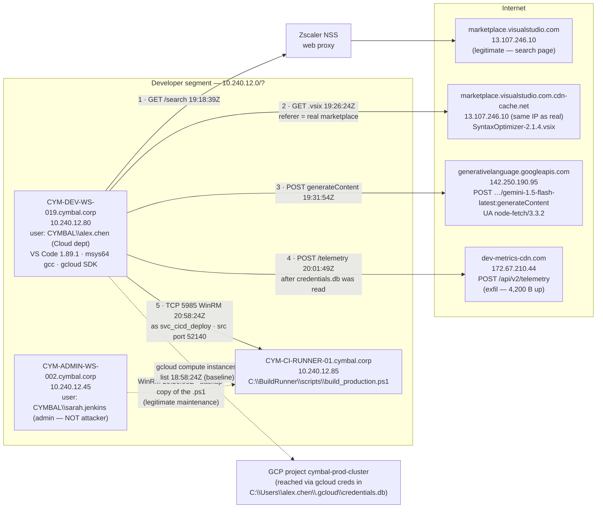

> [!success] Solved — 2026-10-30 05:13 (platform-local) · 6/6 accepted · "Scenario Pwned"
> No `HTB{}` string exists for this room — it is question-graded, six short answers. All six were read from vendor-native raw-log fields in the live SecOps tenant and all six were accepted on first submission.
>
> | # | Question (short) | Answer | Evidence source |
> |---|---|---|---|
> | 1 | Developer who initiated the request to the threat's model | `alex.chen` | Zscaler `user` on the POST to `generativelanguage.googleapis.com/v1beta/models/gemini-1.5-flash-latest:generateContent` |
> | 2 | Package downloaded immediately before the API query | `SyntaxOptimizer-2.1.4.vsix` | Zscaler `url` on the GET from `marketplace.visualstudio.com.cdn-cache.net`, `filetype=VSIX` |
> | 3 | Compiled executable dropped in the staging directory | `sys_worker.exe` | Sysmon EID 1 `gcc.exe … -o C:\Users\alex.chen\AppData\Local\Temp\sys_worker.exe` |
> | 4 | Cloud-SDK config file read by the injected process | `credentials.db` | Sysmon EID 1 `cmd.exe /c "type C:\Users\alex.chen\.gcloud\credentials.db"`, parent hollowed `svchost.exe` PID 624 |
> | 5 | External domain the harvested data was POSTed to | `dev-metrics-cdn.com` | Zscaler POST `https://dev-metrics-cdn.com/api/v2/telemetry` |
> | 6 | PowerShell script overwritten on the secondary server | `build_production.ps1` | Sysmon EID 11 on CYM-CI-RUNNER-01, `C:\BuildRunner\scripts\build_production.ps1`, user `svc_cicd_deploy` |
>
> Medium · 850 points · live SecOps instance required for every flag.

> [!info] Scenario, verbatim
> Cymbal Investments' Threat Hunting team has received an intelligence bulletin regarding AI threats. Armed with Google Threat Intelligence (GTI) reporting and Google SecOps SIEM, your mission is to hunt down the initial compromise and identify the adversary's ultimate target in our CI/CD pipeline.

> [!warning] Time display offset in this tenant
> As in Deceptive Click, the SIEM Search grid renders timestamps **one hour later** than the raw log's UTC value (grid `20:31:54` ↔ raw `19:31:54Z`). [Unverified] cause. **Every time below is raw-log UTC** unless marked "grid".

> [!note] Scope of this note
> This note records the hunt — queries, raw-log fields, the evidence timeline, the decoys, and defender takeaways. It deliberately does not reconstruct the internal mechanics of the malicious extension beyond what the Sysmon `RuleName` labels already state.

---

## 0. How the flags were obtained

1. Read the scenario attachment — the GTIG *AI Threat Tracker* report. Pulled the malware-family table for search targets: the Gemini API host `generativelanguage.googleapis.com`, the model string `gemini-1.5-flash-latest`, the "Thinking Robot" artefact name, and the Hugging Face host as an alternative.
2. SIEM Search, 8–26 Oct, on the AI-API hostnames → 28 events, 27 of them a different demo dataset (host `MUGATU`). One Cymbal hit: **alex.chen → generativelanguage.googleapis.com**, 15 Oct. **Flag 1.**
3. Searched the user → 23 events, all 15 Oct. Gave the host **CYM-DEV-WS-019.cymbal.corp**, IP **10.240.12.80**, and the two-hour spine of the incident.
4. **Pivot: proxy by IP plus a hostname regex** → 4 events. Raw Log on each: the `.vsix` URL (**Flag 2**), the `generateContent` POST, the `/api/v2/telemetry` POST (**Flag 5**).
5. Workstation endpoint events (process / file / module-load / network) → 11 events. Raw Log on each: the `gcc … -o …\sys_worker.exe` line (**Flag 3**), the EID 8 into `svchost.exe` PID 624, the EID 3 to the CI runner on 5985 as `svc_cicd_deploy`.
6. Token-harvest read — searched cloud-SDK path keywords across file-path and command-line fields → 3 events. The one whose parent is `svchost.exe` PID 624 running as SYSTEM: `type C:\Users\alex.chen\.gcloud\credentials.db`. **Flag 4.**
7. CI runner — searched the runner's hostname, IP and the service account together → 5 events. Raw Log on the `FILE_CREATION`: `C:\BuildRunner\scripts\build_production.ps1`, `svc_cicd_deploy`, RuleName `T1505.003`. **Flag 6.** Opened the two `sarah.jenkins` rows on the same host and eliminated them (§6).

---

## 1. Shape of the challenge

**Target.** Same `ctf-us-03` SecOps tenant as Deceptive Click, same calendar day (2026-10-15), different victim host and a different intrusion. The scenario zip (`AI_misue.zip`, sic) holds one file: *GTIG AI Threat Tracker: Advances in Threat Actor Usage of AI Tools* (12-page PDF). No answers in it; it tells you which malware family to pattern-match on.

**Log sources observed:**

| Log type | Product | Covered here |
|---|---|---|
| `ZSCALER_WEBPROXY` | Zscaler NSS | Extension download, Gemini API POST, exfil POST, developer noise (GitHub, Jira, Slack, Copilot, Stack Overflow) |
| `WINDOWS_SYSMON` | Microsoft-Windows-Sysmon | EID 1 / 3 / 8 / 11 on CYM-DEV-WS-019, CYM-CI-RUNNER-01 and CYM-ADMIN-WS-002; `RuleName` pre-labelled with ATT&CK |

No Windows Security (4624 / 4769) events surfaced for this incident — the lateral movement is evidenced by Sysmon EID 3 on the source and EID 1 `wsmprovhost.exe` on the destination.

**Scoring.** Six question-graded answers. No flag string.

**The structural facts that mattered:**

* **The GTIG report is a map, not a key.** The tenant data reuses the report's API host, model string and one artefact filename, and nothing else. Search on infrastructure and behaviour, not on the report's IOCs.
* **The developer's baseline makes the attack blend.** alex.chen compiles C from VS Code (`gcc -O3 … gateway.exe` at 19:21Z), runs `gcloud` against `cymbal-prod-cluster`, and has `node`, `npm`, `docker`, `kubectl` all launched from `Code.exe`. A second `gcc` and a `node.exe` daemon under `Code.exe` are invisible on lineage alone; the tells are `%TEMP%` paths and the `.vscode\extensions\…` parent.
* **The decoy is the same file as the answer.** `sarah.jenkins` backed up `build_production.ps1` 40 minutes before the attacker overwrote it. Grid-level reading gives the right filename for the wrong reason; the `svc_cicd_deploy` EID 11 is the answer, the `sarah.jenkins` `copy` is not.

---

## 2. Network map and asset inventory



| Asset | IP | Role | Evidence that fixes it |
|---|---|---|---|
| CYM-DEV-WS-019.cymbal.corp | 10.240.12.80 | Patient zero — developer workstation, Cloud dept | Sysmon `Computer`; Zscaler `clientIP` / `department=Cloud` |
| CYM-CI-RUNNER-01.cymbal.corp | 10.240.12.85 | CI/CD build runner — the "ultimate target" | EID 3 `DestinationHostname`; EID 1 / 11 `Computer` |
| CYM-ADMIN-WS-002.cymbal.corp | 10.240.12.45 | Admin workstation — sarah.jenkins' legitimate WinRM source | EID 3 `SourceIp`; EID 1 `Computer` |
| svc_cicd_deploy | LogonId `0x4E5F2` on the runner | Service account used for the pivot. [Likely] its credential came from the `credentials.db` read — the data shows no decode step | EID 3 `User`; EID 1 / 11 `User` on the runner |
| alex.chen | SID …-1003, LogonId `0x3C4D1` | Victim developer | Sysmon `Security UserID` / `LogonId` |
| sarah.jenkins | LogonId `0x2B5C1` | Admin doing maintenance on the runner — **noise** | §6 |

Subnet masks are not in the data; `/?` is deliberate. [Guessing] 10.240.12.0/24 is a single dev/CI VLAN — workstation, runner and admin box share the third octet. [Inference] If that guess holds, all three in one segment is a finding in itself. WinRM from the workstation to the runner is [Certain] (EID 3 at 20:58:24Z, §4) and is a finding either way (§10, item 8).

The typosquat CDN resolved to **13.107.246.10 — the same IP as the real marketplace**. [Unverified] whether that is authoring shorthand or a deliberate hint that the fake host fronted the real CDN; either way an IP block would not have separated them.

---

## 3. Cyber Kill Chain mapping (defender view)

Phase → what happened → the record it rests on → where a control could have broken the chain. Times raw-log UTC, 2026-10-15.

| # | Phase | What happened | Basis (record) | Confidence | ATT&CK | Break point |
|---|---|---|---|---|---|---|
| 1 | Reconnaissance | Outside the evidence. The look-alike host imitates the real extension marketplace, which implies the adversary knew the developer tooling in use. | No record; inferred from the host name | [Inference] | — | Look-alike-domain monitoring |
| 2 | Weaponization | A look-alike extension package, `SyntaxOptimizer-2.1.4.vsix`, served from `marketplace.visualstudio.com.cdn-cache.net`. | Zscaler `url`, `filetype=VSIX` (19:26:24) | [Certain] it was served. [Inference] it was prepared in advance. | — | Domain watch; extension allow-list |
| 3 | Delivery | 19:26:24 — VS Code fetched the `.vsix` from the look-alike host while the developer was on the real marketplace page (referer). The proxy allowed it with `threatname=None`. | Zscaler `useragent=VSCode/1.89.1`, `refererURL`, `action=Allowed`, `threatname=None` | [Certain] | T1195.002 (weakest ID, §9) | Proxy block on newly seen look-alike hosts; extensions only from the official marketplace |
| 4 | Exploitation | 19:28:09 — the extension's `node.exe` daemon started under `Code.exe` (Sysmon RuleName T1059.007). | Sysmon EID 1, PID 6720, parent `Code.exe` | [Certain] the daemon ran. [Inference] the developer installed it. | T1204.002 · T1059.007 | Signed-publisher extension policy |
| 5 | Installation | No service, task or registry persistence on the workstation. Instead: 19:31:54 a Gemini API call with a Node user agent; 19:32–19:33 a C source file written to `%TEMP%` and compiled into `sys_worker.exe` with the developer's own `gcc`; 19:41:19 Sysmon EID 8 into SYSTEM `svchost.exe` PID 624 (RuleName T1055.012). | Zscaler POST `generateContent`, `useragent=node-fetch/3.3.2`; Sysmon EID 11 `cache_worker.c`, EID 1 `gcc` PID 7140, EID 8 to PID 624; R3 (all event types for the host, 15–16 Oct) shows no persistence event | [Certain] for the logged events and for R3's scope | T1055.012 | Alert on compilers launched by an extension process; alert on EID 8 into SYSTEM services from `%TEMP%` binaries |
| 6 | Command & Control | No beacon channel. The only outbound traffic from the attack chain is the Gemini API call and one exfiltration POST. | Proxy rows for 10.240.12.80 in R3 and R6 | [Certain] for the proxy logs | T1071.001 | Egress allow-list for developer workstations; flag non-browser user agents to AI APIs |
| 7 | Actions on Objectives | 19:54:19 the cloud-SDK credential store was read from the injected process (Flag 4). 20:01:49 4,200 bytes were POSTed to `dev-metrics-cdn.com` (Flag 5). 20:58:24 WinRM to the CI runner as `svc_cicd_deploy`. 21:11:09 `build_production.ps1` was overwritten (Flag 6). No run of the modified script is logged. | Sysmon EID 1 PID 7890, parent `svchost.exe` PID 624; Zscaler POST 20:01:49; Sysmon EID 3 20:58:24; EID 1 `wsmprovhost.exe` 21:04:09 and EID 11 21:11:09 on the runner | [Certain] for the events. [Likely] the service-account credential came from the store read. | T1552.001 · T1041 · T1078.002 · T1021.006 · overwrite unmapped (§9) | Secrets out of local credential stores; service-account logon scope; build-script integrity monitoring |
| — | *End state (beyond the model)* | No later write to or run of `build_production.ps1` appears in the runner's events. | R7 (runner, 15 Oct 18:00 → 16 Oct 12:00) | [Certain] for R7. [Unverified] beyond it. | — | Restore the script from version control; rotate the gcloud credential and `svc_cicd_deploy` |

The earliest break point is **Delivery**: one proxy rule on `filetype=VSIX` from a non-Microsoft host (§10, item 1) stops the chain before anything runs.

### 3.1 What the Kill Chain view leaves out

Only the limits that bite in this room:

| Limit | Here |
|---|---|
| "C2" assumes an implant beaconing out | No beacon exists. The only outbound calls are one AI API request and one exfiltration POST (phase 6). |
| Installation is not where the persistence is | The workstation has no persistence. The persistence-shaped step is the build-script overwrite on a second host, which the model files under Actions on Objectives. |
| No phase for credential reuse across a trust boundary | The gcloud credential-store read on the workstation precedes `svc_cicd_deploy` use on the CI runner by 57 minutes; no decode step is logged (§13). |
| No place for the adversary's use of a third-party AI service | The Gemini API call (19:31:54) is filed under Installation because it sits between the daemon starting and the compile. Its purpose is not shown in the logs [Inference]. |
| Linear, with no end state | No run of the modified script is logged, so the intended effect (a poisoned build) is outside the evidence. |

### 3.2 Diamond Model — summary

Method: the Diamond Model of Intrusion Analysis.

| Vertex | In this room | Evidence | Confidence |
|---|---|---|---|
| Adversary | Unattributed. The scenario attaches GTIG's *AI Threat Tracker*; the tenant data reuses that report's Gemini API host, model string and one artefact name (§1, §12). That links the activity to a report, not to an operator. | §4 timeline; scenario attachment | [Certain] for the reuse. [Inference] the artefacts follow the report's PROMPTFLUX entry (§12). No attribution made. |
| Capability | Malicious VS Code extension `SyntaxOptimizer-2.1.4.vsix` and its `node.exe` daemon (T1059.007); a Gemini API call ([Inference] ATLAS AML.T0040, §9); on-host compile of `sys_worker.exe` with the victim's own `gcc`; hollowing into SYSTEM `svchost.exe` (T1055.012); credential-store read (T1552.001); HTTPS exfiltration (T1041, T1071.001); `svc_cicd_deploy` over WinRM (T1078.002, T1021.006); build-script overwrite (unmapped, §9). | Sysmon EID 1 / 3 / 8 / 11; Zscaler (§4) | [Certain] for the events |
| Infrastructure | **Delivery:** `marketplace.visualstudio.com.cdn-cache.net`, Type 1 [Inference]; it resolved to 13.107.246.10, the real marketplace's address (§2). **AI service:** `generativelanguage.googleapis.com` (142.250.190.95), Type 2: a legitimate Google service called by the adversary's code. **Exfiltration:** `dev-metrics-cdn.com` (172.67.210.44), Type 1 [Inference], Cloudflare range [Likely]. | Zscaler `url`, `serverip` (§4) | As marked |
| Victim | **Persona:** Cymbal Investments; a Cloud-department developer; production GCP credentials and the CI/CD pipeline. **Asset:** CYM-DEV-WS-019; CYM-CI-RUNNER-01; `alex.chen`; `svc_cicd_deploy`; `C:\Users\alex.chen\.gcloud\credentials.db`. | §2 asset table | [Certain] |

**Result:** Success. Confidentiality compromised (credential store read, 4,200 bytes posted) and integrity compromised (`build_production.ps1` overwritten); the downstream effect of the build change is Unknown · **Direction:** Victim-to-Infrastructure · **Phases:** Kill Chain 2–7

**Limits** (part of the honest-scope rule): the adversary vertex holds a report link and nothing more, and one room is not an attribution. Infrastructure types rest on the proxy fields shown; registration and hosting records were not queried. Cross-room comparison belongs in [[00_MOC-HTB-COLDROOM2026-Operation-Cymbal-Cold-Room-Event]].

---

## 4. Evidence timeline

All times raw-log UTC, 2026-10-15. **[Certain]** = read from a raw log field. Rows are observations; interpretation is limited to the Sysmon `RuleName` the scenario author attached.

| Time | Host | Event | Key raw fields | RuleName / note |
|---|---|---|---|---|
| 18:58:24Z | WS-019 | EID 1 `gcloud.cmd compute instances list --project=cymbal-prod-cluster` | parent `Code.exe` PID 4120, LogonId 0x3C4D1 | Baseline — dev has prod GCP creds on disk |
| 19:18:39Z | WS-019 | GET `https://marketplace.visualstudio.com/search` | `useragent=Mozilla/5.0`, `urlcategory=Computers` | Baseline — real marketplace |
| 19:21:19Z | WS-019 | EID 1 `gcc.exe -O3 …\Projects\api-gateway\main.c -o …\bin\gateway.exe` | parent `Code.exe` | Baseline — dev compiles C |
| **19:26:24Z** | WS-019 | **GET `https://marketplace.visualstudio.com.cdn-cache.net/extensions/DevTools/SyntaxOptimizer/2.1.4/SyntaxOptimizer-2.1.4.vsix`** | `filetype=VSIX`, `useragent=VSCode/1.89.1`, `refererURL=https://marketplace.visualstudio.com/items`, `action=Allowed`, `status=200`, `threatname=None` | **Flag 2** |
| 19:28:09Z | WS-019 | EID 1 `node.exe "C:\Users\alex.chen\.vscode\extensions\devtools.syntaxoptimizer-2.1.4\out\optimizer-daemon.js"` | PID 6720, parent `Code.exe` | T1059.007 — extension daemon |
| **19:31:54Z** | WS-019 | **POST `https://generativelanguage.googleapis.com/v1beta/models/gemini-1.5-flash-latest:generateContent`** | `user=alex.chen`, `useragent=node-fetch/3.3.2`, `urlcategory=Artificial`, 4,200 B up / 14,200 B down | **Flag 1** — model string matches the GTIG report; UA is Node, not a browser |
| 19:32:19Z | WS-019 | EID 11 `C:\Users\alex.chen\AppData\Local\Temp\thinking_robot_log.txt` | Image `node.exe` PID 6720 | T1074 — artefact name from the GTIG report |
| 19:32:39Z | WS-019 | EID 11 `C:\Users\alex.chen\AppData\Local\Temp\cache_worker.c` | Image `node.exe` PID 6720 | T1074 |
| **19:33:24Z** | WS-019 | **EID 1 `gcc.exe -O2 …\Temp\cache_worker.c -o …\Temp\sys_worker.exe`** | PID 7140, parent `node.exe` PID 6720 (the daemon) | **Flag 3** |
| 19:38:09Z | WS-019 | EID 1 `npm.cmd install express axios dotenv` | parent `Code.exe` | Noise |
| 19:41:19Z | WS-019 | EID 8 `sys_worker.exe` PID 7140 → `svchost.exe` **PID 624**, `TargetUser=NT AUTHORITY\SYSTEM` | `StartAddress=0x00007FF7B4920000` | T1055.012 — same target PID as Deceptive Click |
| **19:54:19Z** | WS-019 | **EID 1 `cmd.exe /c "type C:\Users\alex.chen\.gcloud\credentials.db"`** | PID 7890, parent `svchost.exe` PID 624 (`-k netsvcs -p`, SYSTEM), `User=CYMBAL\alex.chen` | **Flag 4** — T1003.008 "Cloud Tokens" |
| **20:01:49Z** | WS-019 | **POST `https://dev-metrics-cdn.com/api/v2/telemetry`** | `serverip=172.67.210.44`, 4,200 B up, `useragent=Mozilla/5.0`, `pagerisk=15`, `Allowed` | **Flag 5** — 7½ min after the read |
| 20:26:09Z | ADMIN-WS-002 | EID 3 `powershell.exe` → CI-RUNNER-01 :5985 | `User=sarah.jenkins`, `SourceIp=10.240.12.45` | Legitimate admin — §6 |
| 20:31:24Z | CI-RUNNER-01 | EID 1 `cmd.exe /c "copy …\build_production.ps1 …\backups\build_production.ps1.bak"` | `User=sarah.jenkins`, LogonId 0x2B5C1, parent `svchost.exe -k DcomLaunch` | Legitimate backup of the target file — §6 |
| 20:58:24Z | WS-019 | EID 3 `powershell.exe` → `CYM-CI-RUNNER-01.cymbal.corp` 10.240.12.85 **:5985** | `User=CYMBAL\svc_cicd_deploy`, `SourceIp=10.240.12.80`, `SourcePort=52140` | T1021.006 — the pivot |
| 21:04:09Z | CI-RUNNER-01 | EID 1 `wsmprovhost.exe -Embedding` | PID 3410, `User=CYMBAL\svc_cicd_deploy`, LogonId 0x4E5F2, parent `svchost.exe -k DcomLaunch` | T1505.003 — WinRM remote shell |
| **21:11:09Z** | CI-RUNNER-01 | **EID 11 `C:\BuildRunner\scripts\build_production.ps1`** | Image `powershell.exe` PID 3410, `User=CYMBAL\svc_cicd_deploy` | **Flag 6** — T1505.003 "Build Hook Injection" |

**Objective, as evidenced:** [Certain] the CI/CD build runner's production build script was overwritten under the deploy service account. [Certain] No build execution of the modified script and no downstream artefact appear in the data read — the chain ends at the overwrite. [Likely] the intended effect is a poisoned production build on the next pipeline run.

> [!example] Evidence exhibit — the overwrite, not the backup
> | Field | Value |
> |---|---|
> | Event | Sysmon EID 11 (FileCreate) |
> | Host | `CYM-CI-RUNNER-01.cymbal.corp` |
> | `TargetFilename` | `C:\BuildRunner\scripts\build_production.ps1` |
> | `Image` | `powershell.exe` (PID 3410) |
> | `User` | `CYMBAL\svc_cicd_deploy` |
> | `RuleName` | `T1505.003` "Build Hook Injection" (author's label, excluded in §9) |
>
> Source: `WINDOWS_SYSMON`, 2026-10-15 21:11:09Z (raw). [Certain] — every value read from the original record.
>
> **Limits of the proof:** EID 11 records a file write, not its content; what changed in the script is not in the data. The `sarah.jenkins` `copy` at 20:31:24Z touched the same filename and is disqualified in §6.

---

## 5. Search log — every query, what came back, how it was reviewed

Case sensitivity **Off**. All queries UDM syntax in SIEM Search, run by URL. "Review" states which tab and which raw field was read.

| # | Time window (UTC) | Query | Result | How reviewed | Yielded |
|---|---|---|---|---|---|
| R0 | — | Scenario PDF, `pdftotext` + grep for family names / API hosts | — | Read the malware-family table | Search targets: `generativelanguage`, `huggingface`, `gemini-1.5-flash-latest`, `thinking_robot` |
| R1 | 10-08 → 10-26 | `target.hostname = /huggingface\|generativelanguage\|openai\|anthropic\|gemini\|hf\.co/ nocase OR target.url = /huggingface\|generativelanguage\|openai\|anthropic/ nocase` | 28 events, 4 alerts | Grid scraped; 27 rows filtered out as host `MUGATU` (unrelated demo data); 4 alerts were a closed "Chrome Extension → chat.openai.com" detection, unrelated | One Cymbal hit: alex.chen → generativelanguage.googleapis.com, 15 Oct |
| R2 | 10-08 → 10-26 | `principal.user.userid = /alex.chen/ nocase OR target.user.userid = /alex.chen/ nocase` | 23 events | Grid scraped: timestamp / type / summary / host / process | Host CYM-DEV-WS-019, IP 10.240.12.80, full event spine |
| R3 | 10-15 12:00 → 10-16 12:00 | `principal.hostname = /CYM-DEV-WS-019/ nocase OR principal.ip = "10.240.12.80" OR target.ip = "10.240.12.80" OR src.ip = "10.240.12.80"` | 23 events | Grid scraped; confirmed R2 had missed nothing keyed to SID instead of username (the EID 8 row shows `S-1-5-21-…-1003`, not `alex.chen`) | Same 23; `svc_cicd_deploy` → CI runner connection surfaced |
| R4 | same | `target.file.full_path = /gcloud\|aws\|azure\|credentials\|access_tokens/ nocase OR principal.file.full_path = /gcloud\|credentials\|access_tokens/ nocase OR target.process.command_line = /gcloud/ nocase` | 3 events | Opened all 3 → **Raw Log (Sysmon XML)** → `CommandLine`, `ParentImage`, `ParentProcessId`, `ParentUser`, `User`, `LogonId`, `RuleName` | **Flag 4**; sarah.jenkins `gcloud auth list` on ADMIN-WS-002 eliminated; legit `gcloud compute instances list` baseline |
| R5 | 10-15 19:00 → 23:00 | `principal.hostname = /CYM-DEV-WS-019/ nocase AND (metadata.event_type = "PROCESS_LAUNCH" OR … "FILE_CREATION" OR … "PROCESS_MODULE_LOAD" OR … "NETWORK_CONNECTION")` | 11 events | Opened all 11 → Raw Log XML → `CommandLine`, `ParentImage`, `ParentCommandLine`, `TargetFilename`, `Source/TargetProcessId`, `DestinationIp/Port`, `RuleName` | **Flag 3**; EID 8 target 624; EID 3 to runner :5985 as svc_cicd_deploy; both baseline gcc / gcloud lines |
| R6 | 10-15 18:00 → 23:00 | `principal.ip = "10.240.12.80" AND metadata.event_type = "NETWORK_HTTP" AND target.hostname = /cdn-cache\|generativelanguage\|dev-metrics\|marketplace/ nocase` | 4 events | Opened all 4 → **Raw Log (Zscaler key=value)** → `url` (query string stripped), `refererURL`, `requestmethod`, `filetype`, `useragent`, `serverip`, `requestsize`, `responsesize`, `urlcategory`, `user` | **Flags 1, 2, 5** |
| R7 | 10-15 18:00 → 10-16 12:00 | `principal.hostname = /CYM-CI-RUNNER-01/ nocase OR target.hostname = /CYM-CI-RUNNER-01/ nocase OR principal.user.userid = /svc_cicd_deploy/ nocase OR target.user.userid = /svc_cicd_deploy/ nocase OR principal.ip = "10.240.12.85" OR target.ip = "10.240.12.85"` | 5 events (+12 entity-context rows the grid prepends) | Opened all 5 → Raw Log XML → `TargetFilename`, `User`, `LogonId`, `CommandLine`, `ParentImage`, `SourceIp`, `RuleName` | **Flag 6**; `wsmprovhost.exe` parent chain; both sarah.jenkins rows eliminated |

**Review discipline:** (1) find the row, (2) open it, (3) **Raw Log** tab, (4) read the vendor-native field, (5) only then accept the value. The grid `Summary` column and Gemini were orientation only.

---

## 6. Decoys and noise, and what disqualified each

* **`sarah.jenkins` backing up `build_production.ps1` on CYM-CI-RUNNER-01 at 20:31:24Z.** Same host, same file as Flag 6. Disqualified by: different user, different source (10.240.12.45 / CYM-ADMIN-WS-002, not the compromised workstation), different `LogonId` (`0x2B5C1` vs attacker's `0x4E5F2`), action is `copy` to a `backups\` path, and it is **40 minutes before** the attacker's overwrite. This is the "legitimate maintenance at almost the same time" the event brief promises. [Certain] not attacker.
* **`sarah.jenkins` `gcloud auth list` on CYM-ADMIN-WS-002 at 19:51:39Z.** Surfaced by the `gcloud` keyword in R4. Different host, parent is an interactive `cmd.exe` under her own account, not a SYSTEM svchost. Eliminated.
* **27 `MUGATU` / `hanselmcdonald@` rows in R1.** A separate demo dataset sharing the tenant; daily hits to AI hosts over the whole window. Filtered on hostname.
* **4 "Chrome Extension Contacting Newly Observed Domain" alerts in R1.** Closed curated detections on `chat.openai.com`, 15–18 Oct, different data. Not part of this incident.
* **Developer noise on WS-019** — `npm install express axios dotenv` (19:38Z), `docker.exe`, `kubectl.exe`, `cr.cymbal.corp`, Jira, Slack, Copilot, Stack Overflow, `console.cloud.google.com`. All parent `Code.exe` or browser, all alex.chen's own session. Kept out of the timeline except where they establish baseline.
* **`gcc.exe -O3 … gateway.exe` at 19:21:19Z.** Legitimate project build from VS Code. It is what makes the 19:33Z `gcc` look ordinary on lineage alone; the discriminators are the `%TEMP%` input/output paths and the `node.exe` extension-daemon parent.

---

## 7. Final payload

No exploit payload — the deliverable is the six answers and the queries that reproduce them (full set in §5; minimal path below).

```
# Flag 1 — window 2026-10-08 → 10-26; the one non-MUGATU row; Raw Log → user
target.hostname = /generativelanguage/ nocase
#   alex.chen

# Flags 2, 5 — window 2026-10-15T18:00Z → 23:00Z; Raw Log → url (strip ?query), filetype
principal.ip = "10.240.12.80" AND metadata.event_type = "NETWORK_HTTP" AND target.hostname = /cdn-cache|dev-metrics/ nocase
#   SyntaxOptimizer-2.1.4.vsix
#   dev-metrics-cdn.com

# Flag 3 — window 19:00Z → 23:00Z; the gcc row with parent node.exe; Raw Log → CommandLine
principal.hostname = /CYM-DEV-WS-019/ nocase AND metadata.event_type = "PROCESS_LAUNCH" AND target.process.file.full_path = /gcc/ nocase
#   sys_worker.exe

# Flag 4 — window 10-15 12:00Z → 10-16 12:00Z; the row with ParentImage svchost.exe; Raw Log → CommandLine
target.process.command_line = /gcloud/ nocase
#   credentials.db

# Flag 6 — window 18:00Z → 10-16 12:00Z; the FILE_CREATION row; Raw Log → TargetFilename, User
principal.hostname = /CYM-CI-RUNNER-01/ nocase AND metadata.event_type = "FILE_CREATION"
#   build_production.ps1
```

---

## 8. Tools & techniques

Google SecOps SIEM Search (UDM) · Event Viewer Raw Log tab (Zscaler key=value, Sysmon XML) · `pdftotext` 24.x for the GTIG report · Claude in Chrome driving the tenant and scraping the shadow-DOM results grid via `javascript_tool` · GTIG *AI Threat Tracker* (Nov 2025 report, scenario attachment) for family-level priming. Versions: SecOps is a SaaS tenant; no version was recorded for it or for the browser extension.

Concepts: threat-report-to-hunt translation (search on infrastructure and behaviour, not IOCs) · typosquat detection by referer / hostname suffix · User-Agent as a process-identity signal in proxy logs (`node-fetch` vs `VSCode/` vs `Mozilla/`) · `%TEMP%` path + extension-directory parent as the discriminator against a developer's own toolchain · Sysmon EID 8 source/target PID semantics · `wsmprovhost.exe` as the WinRM remote-shell parent · LogonId as the per-session thread · same-file decoy elimination by user + source IP + LogonId + time order.

---

## 9. MITRE ATT&CK

| Technique | Phase | Justification (one line, from the evidence) |
|---|---|---|
| T1195.002 Supply Chain Compromise: Software Supply Chain | Delivery | `.vsix` fetched from a typosquat CDN while on a real marketplace page |
| T1204.002 User Execution: Malicious File | Exploitation | Extension installed and activated by the developer in VS Code |
| T1059.007 JavaScript | Exploitation | `node.exe …\out\optimizer-daemon.js`, Sysmon RuleName verbatim |
| T1055.012 Process Hollowing | Priv-Esc | EID 8 from `sys_worker.exe` into SYSTEM `svchost.exe` PID 624, RuleName verbatim |
| T1552.001 Unsecured Credentials: Credentials in Files | Credential Access | `type …\.gcloud\credentials.db` from the hollowed process. The author's RuleName T1003.008 is excluded (honest scope below) |
| T1041 Exfiltration Over C2 Channel · T1071.001 Web Protocols | Exfiltration | POST to `dev-metrics-cdn.com/api/v2/telemetry` 7½ min after the read |
| T1078.002 Valid Accounts: Domain | Lateral Movement | `svc_cicd_deploy` used from the compromised workstation |
| T1021.006 Windows Remote Management | Lateral Movement | EID 3 to runner :5985 + `wsmprovhost.exe` parent on the runner |
| *Unmapped* — build-script overwrite | Persistence (intended) | Overwrite of `build_production.ps1` under `svc_cicd_deploy`. The author's RuleName T1505.003 "Build Hook Injection" is excluded (honest scope below) |

> [!warning] Honest scope
> Mapped to **ATT&CK v20** (v19 IDs unchanged), checked on 15 Nov 2026 against the ATT&CK v19 and v20 change logs. After v19, T1055.012 sits under Privilege Escalation and Stealth. IDs were first assigned without the live matrix open. Three of the remaining IDs (T1059.007, T1055.012, T1021.006) match the scenario author's Sysmon `RuleName` labels and are therefore the author's mapping, not an independent one. The weakest ID is **T1195.002** — the data shows a download from a look-alike host, not a compromised upstream publisher; T1189 or plain T1204 would fit equally well. Two of the author's `RuleName` labels are **excluded** [Likely: checked against ATT&CK as known to mid-2026; neither ID appears in the v19 or v20 change references above]. **T1505.003** names *Server Software Component: Web Shell*, and nothing here is a web shell. **T1003.008** names *OS Credential Dumping: /etc/passwd and /etc/shadow*, a Linux technique; the evidence is a read of a Windows gcloud credential file, which T1552.001 covers. The build-script overwrite is left unmapped because ATT&CK has no clean technique for a CI build hook. [Inference] T1195.002 (a poisoned build reaching downstream consumers) and T1546 (Event Triggered Execution) are candidates; neither is evidenced, because no run of the modified script is logged. ATT&CK v20 (October 2026) added AI techniques, including T1698/T1699 prompt injection and T1700 AI-Enabled Exfiltration. None fits: the API call was not an injection, and the data left by a plain HTTPS POST to `dev-metrics-cdn.com`, not through the AI service. The call stays recorded as T1071.001 traffic. [Inference] MITRE ATLAS **AML.T0040 AI Model Inference API Access** describes the call itself (MITRE ATLAS v5–6); it is not catalogued in frontmatter.

---

## 10. Detection / blue-team notes

Earliest to latest opportunity:

1. **Proxy: `filetype=VSIX` from a host that is not `*.visualstudio.com` / `*.vsassets.io`, with a `visualstudio.com` referer.** Fires at 19:26Z. The hostname suffix `.cdn-cache.net` is the whole signal; the IP matched the real CDN, so an IP allow-list would not have helped.
2. **Proxy: non-browser User-Agent (`node-fetch/*`, `python-requests/*`, `curl/*`) to an LLM API host from a workstation.** Fires at 19:31Z. Fix for the class: route sanctioned LLM API use through an egress proxy with per-app allow-listing; alert on direct `generativelanguage.googleapis.com` / `api.openai.com` / `huggingface.co` from endpoints.
3. **Sysmon EID 1: `gcc`/`cl`/`csc` with both input and output under `%TEMP%`, parent not a shell or IDE.** Fires at 19:33Z. The developer's own `gcc -O3` under `Projects\` does not match.
4. **Sysmon EID 1: any process whose parent image is under `.vscode\extensions\`** spawning a compiler, a shell, or a network client. Low-volume, high-value rule on developer fleets.
5. **Sysmon EID 8 with `TargetUser=NT AUTHORITY\SYSTEM` from a `%TEMP%` binary.** Fires at 19:41Z. Did not alert in this tenant.
6. **`type` / `cat` / `Get-Content` against `.gcloud\credentials.db`, `.aws\credentials`, `.azure\accessTokens.json` from a parent that is not the SDK itself.** Fires at 19:54Z. RuleName was already attached; nothing consumed it.
7. **Proxy: POST to a newly observed domain with "telemetry"/"metrics" in the path within N minutes of a credential-file read on the same host.** Cross-source correlation; fires at 20:01Z.
8. **WinRM to a CI runner from any host that is not the admin jump box, or under a service account from a workstation subnet.** Fires at 20:58Z. The legitimate pattern (ADMIN-WS-002 → runner) was visible 30 minutes earlier for comparison.
9. **File write to `C:\BuildRunner\scripts\*.ps1` by anything other than the pipeline's own updater.** Fires at 21:11Z. Fix for the class: build scripts in version control, runner checks out at job start, scripts directory read-only to the deploy account.

Fix for the class, not the instance: (a) a developer workstation that holds production cloud credentials on disk in a readable file; (b) a deploy service account usable over WinRM from that workstation; (c) CI build scripts writable by that account. Any one of the three broken ends the chain at that step.

---

## 11. Method notes

* **Start from the attachment.** The GTIG report gave `generativelanguage.googleapis.com` and `gemini-1.5-flash-latest` before the first query. One wide hostname search over 18 days found the victim in one step; the rest was a pivot on user → host → IP.
* **The wide search was mostly noise** — 27 of 28 hits were a second demo dataset in the same tenant (`MUGATU`). Filter on namespace or hostname early.
* **Grid times are +1 h versus raw UTC** — same offset as Deceptive Click; every timestamp in this note re-read from the raw field.
* **The browser extension refuses to return any JS value containing a query string**; `url=` fields had to be returned with `?…` stripped. Two proxy rows (the real marketplace search, the Gemini POST) carried query strings and needed that handling.
* **Page helpers in `window` do not survive a navigation.** Define the shadow-DOM text walker inline, or re-define it after every `navigate`, or the next batch fails silently.
* **The grid prepends entity-context rows** (12 rows with `14 days ago` / `15 days ago` columns) when the query names an IP; the timestamp regex has to be anchored to the incident date to skip them.

---

## 12. Blind alleys

* **Hugging Face / PROMPTSTEAL.** The report's "first LLM-in-the-wild" family uses the Hugging Face API; nothing in the tenant touches it. The scenario is modelled on PROMPTFLUX's API and artefact names, not PROMPTSTEAL's.
* **QUIETVAULT / npm tokens.** `npm install express axios dotenv` at 19:38Z looked like a supply-chain lead; it is ordinary developer activity from `Code.exe`, and no `.npmrc` / GitHub-token read exists in the data. Do not re-walk.
* **Windows Security 4624 on the CI runner.** None surfaced in R7, which searched the runner's hostname, its IP 10.240.12.85 and `svc_cicd_deploy` across all event types, 15 Oct 18:00 → 16 Oct 12:00 (§5); the pivot is evidenced by Sysmon only. A dedicated `metadata.product_event_type = "4624"` query was not logged in §5, so the zero rests on R7. [Certain] for R7's scope.

---

## 13. Open items

* [Unverified] **How `svc_cicd_deploy` was obtained.** The data shows `credentials.db` read, exfil, then the account in use 57 minutes later. No decode / crack / reuse step is logged. [Likely] the scenario intends the gcloud credential store to have contained it; could equally be a second artefact not in the logs.
* [Unverified] **Whether the modified `build_production.ps1` ever ran.** No pipeline execution after 21:11Z in the sources queried. If a third Cold Room scenario covers a poisoned build, this is the hand-off.
* [Unverified] **Why the typosquat host resolved to the real marketplace IP** (13.107.246.10).
* [Guessing] **"The Tell" candidates, cross-incident:** `svchost.exe` PID 624 as the hollowing target in both Deceptive Click and Rogue Synthesis; the `/api/v*/telemetry` exfil-path pattern (`cdn-metrics-analytics.net/api/v1/telemetry` there, `dev-metrics-cdn.com/api/v2/telemetry` here); the exfil host here in Cloudflare-range space (`172.67.210.44`), while the Deceptive Click stage-2 host `198.51.100.84` is not Cloudflare: it sits in RFC 5737 TEST-NET-2, a range reserved for documentation [Certain on the range]; `sarah.jenkins` as the planted-noise admin in both. Carry into the third scenario and diff.
* [Unverified] **`category: AI Misuse`** was taken from the scenario page label. Replace verbatim if the platform lists it differently.
* `solves` omitted — not displayed on the scenario page.
* **Publication.** Neither the HTB event page (read 17 Nov 2026) nor the Google Cloud Security Community event page and two organiser threads (read 15 Nov 2026) set any rule on write-ups, and HTB's general CTF rules restrict sharing only during the competition. Published after the event closed on 1 Nov 2026.
* [Unverified] **`mitre_version` not recorded**. The ATT&CK release the original mapping was assigned against was not noted when the note was written, so the field is left out rather than invented. `mitre_v20` records the 15 Nov 2026 re-check.

---

## Cross-references

* Event sibling (each Cold Room room has its own category, so there are no category siblings): [[HTB-COLDROOM2026-Deceptive-Click-FakeUpdates-DriveBy-Kerberoast-WinRM-Data-Staging]] — same tenant, same day, shared Tell candidates (§13).
* Event sibling: [[HTB-COLDROOM2026-OAuth-Heist-Identity-Compromise-OAuth-Persistence-Service-Account-Reuse]] — same tenant, same day, same planted admin.
* Event MOC: [[00_MOC-HTB-COLDROOM2026-Operation-Cymbal-Cold-Room-Event]]

## Change Log

* 2026-11-15 — Final-audit fixes. `mitre_v20` added as the 15 Nov re-check of the current list; `mitre_version` noted in §13 as unrecorded. §13 adds the publication check.
* 2026-11-15 — Conformance pass. **ATT&CK correction:** T1003.008 and T1505.003 removed from `mitre:` and §9. Both were the scenario author's `RuleName` labels and name techniques the evidence does not show (/etc/passwd dumping; web shell); the build-script overwrite is left unmapped (§9). §3 table rebuilt to a fixed template, with new §3.1 (Kill Chain limits) and §3.2 (summary diamond). §4 gains an evidence exhibit for Flag 6. §2 segment claim labelled. §12 4624 blind alley bounded to R7. §8 states that tool versions were not recorded. Cross-references relabelled as event siblings. `updated` refreshed. No answer changed.
* 2026-11-15 — §13 Tell candidate corrected: `198.51.100.84` is in the RFC 5737 documentation range, not Cloudflare space.
* 2026-11-15 — Audit refresh. New §3 Cyber Kill Chain mapping (defender view); later sections renumbered §4–§13 and in-text references updated. ATT&CK honest-scope note mapped to v20 and updated for v20's AI techniques (none fits; ATLAS AML.T0040 noted, not catalogued). Links to the OAuth Heist sibling and the MOC.
* 2026-10-30 — All six flags accepted ("Scenario Pwned", 05:13 platform-local). `status` draft → complete; result callout updated; submission open item removed. No analytical content changed.
* 2026-10-30 — Note created from a live solve in the `ctf-us-03` SecOps tenant. All six answers read from raw-log fields. §4 search log and §5 decoy table written to the same shape as the Deceptive Click note. Scope deliberately limited to hunt method, evidence and defence (see the scope callout). `status: draft` pending flag submission.
